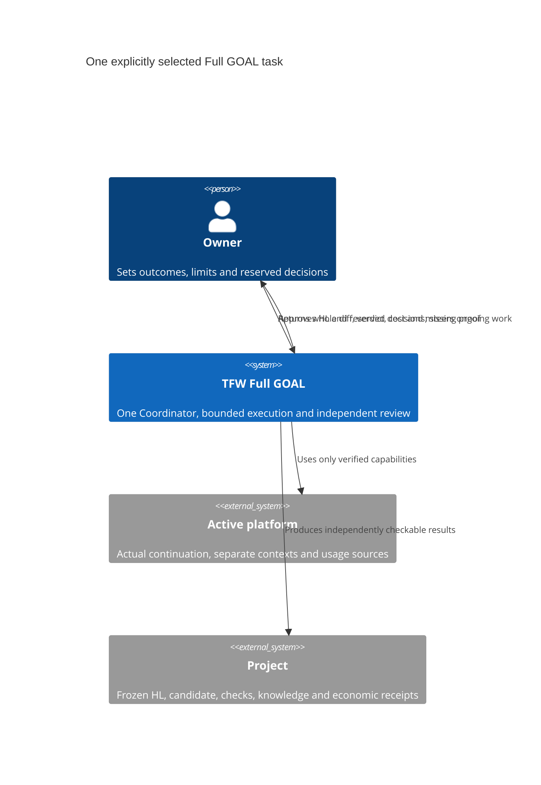
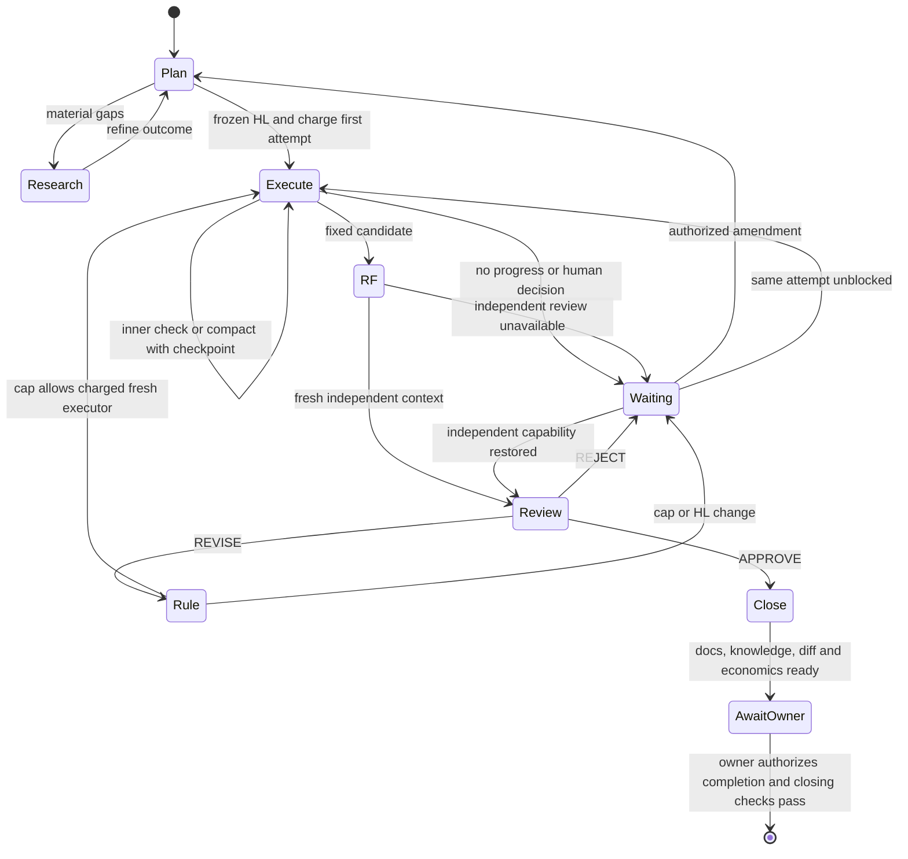

# Full GOAL — До результата

**Enter only by explicit owner selection of `coordination_mode: goal` in Full Plan.** A goal sentence, platform `/goal`, file, transport, Daily or Assisted never selects this mode. It is a fourth choice, not a modifier to manual/visible-agents/subagents. Use the active role's normal evidence, return, safety and close rules. For this mode only the rules below replace a separate TS, phase-chat topology and same-pair corrections. No extra public command or personal installation is required.

**How to start:** use `/tfw-plan`. At new-task entry the Coordinator offers the four Full modes. You can select one in the request: “`/tfw-plan` — use GOAL for this task, up to three outer attempts including the first. Show me the diff before merging.” An explicit selection need not be asked twice. Three is an example, never a default. There is no separate `/tfw-goal` command. A platform's native goal, if available, belongs to execution after HL approval.

## Agree the goal

The same Coordinator follows [Plan from entry through HL approval](plan.md#planning-steps) and uses the [ordinary master HL template](../templates/HL.md). Keep Plan's Strategic Architect discussion: compare real alternatives, challenge both the proposal and the recommendation, and apply Saint-Exupéry when considering what can be removed. Before asking for approval, show the owner the concrete before/after result, its value flow and the alternatives; preserve them in the HL. This page changes what happens **after** those gates. It supplies neither a shorter HL nor a second planning pass. One main conversation remains the owner's address throughout.

Plan establishes the beneficiary and usable result, acceptance checks, exclusions, constraints, authority and reserved decisions in the master HL. Carry the ordinary scope/accounting baseline, VALUE selector, permitted budget and evidence there once. Use the same approval and amendment authority as Full. Contract enough to judge the outcome; leave implementation open. Reuse existing infrastructure and verified research. For material gaps group hypotheses by decision, use authorized separate researchers, challenge an assumption that could overturn the plan, and examine a comparable process, algorithm or UX in external primary sources. Cite fit and counterevidence or the actual access gap. Reuse recent evidence when it answers the question; only a decision-changing uncertainty justifies another iteration. Return to the owner when findings change the intended result.

Before execution obtain a positive owner-selected outer limit, the agreed context arrangement, grant and reservations. The accepted HL contains the ordinary frozen contract line with the accountable team handle and the numeric limit, e.g.:

    > **Contract**: 🔒 FROZEN — approved by saubakirov 2026-11-04
    > **Goal attempt limit**: 3

Commit the approved HL first. `status.authority` is its path; `goal_ref` is that task-local HL path **@ full reachable Git commit**. Read the bytes at that commit, not the newest working copy. `coordination_authority` still records the separate launch mandate. Before a freeze, `goal_attempt: 0` and no `goal_ref` permit planning/research only. New execution with an absent, draft, wrong-task or unreachable reference, unapproved cap or ambiguous expected result is refused. A change of HL/limit requires actual owner approval and a new immutable epoch before dependent work; preserve old evidence, charges and attempts. Switching into or out of GOAL uses the existing explicit selection event at a safe boundary; do not reinterpret old runs.

## Execute and recover

1. End the Plan act. With the explicit sequential mandate the main chat may enter Handoff as first Executor; it cannot rule its own scope change or review itself. An explicitly designated fresh first Executor may instead take the handoff. One task status governs the outcome; A–G product stages or a checklist do not create `phase-*` Coordinators or extra owner chats. Use the actual authorized transport per role. Choose model and reasoning before each launch from the cost of error, complexity, verification and rework; record requested versus observable effective setting. Respect a configured-model policy.
2. At the **start** of each new external attempt write a task journal `dispatch` with the next positive `goal_attempt`, exact HL epoch, holder, recipient when known, limits and role. Increment `status.goal_attempt` once, before spending; numbers are contiguous, cannot exceed the frozen limit and survive REVISE, cancellation, compact or amendment. First attempt: `HL_DRAFT/RES → ONB` directly. A ruled retry uses `REV → ONB`. An interrupted attempt that never returned RF still counts. No placeholder TS, `TS_DRAFT` transition, self-dispatch message or synthetic new phase. Keep durable RF and review for every presentation.
3. **Inner loop** in the same execution context: choose a disprovable step, act, check with an oracle, note `attempt.step → outcome, evidence, source bound, next action` in ONB/EV. Honor explicit inner time/token/step caps. Two identical failures without changed evidence require a different discriminating action or a named blocker; no endless retry. A tool call or host wakeup is not a product iteration. If the host offers native goal continuation, activate it only within the agreed scope; do not claim unattended operation, pause or completion where the surface lacks it. A native “complete” proves no product verdict.
4. At compact/wait/transfer record authority epoch, attempt/step, candidate or reachable base, proof, blockers, next act and last measured boundary. Continue the same live attempt from that checkpoint. A fresh independent context starts from files, not copied chat. Preserve partial work; if a **new** execution is needed after an abandoned attempt, charge its start. At a human gate, hold the action that needs the decision and continue any other authorized work. If none remains, leave the goal open awaiting the owner without polling or starting another attempt. Account for actual wakeups separately.
5. Return a task RF with the exact tested candidate, baseline/diff, all HL checks, material unknowns and own economics. The Coordinator alone handles subsequent routing. If the same chat held EXEC, end that act before coordination; do not send to yourself. No human message is required for routinely authorized continuation.

## Full independent review and return

**The owner decides when to pause, stop or complete GOAL.** Before selecting any such action, including in the platform's native goal control, record the owner's explicit instruction for this goal and this action. A status question, a chat archive, an RF, a review verdict, an exhausted attempt limit or silence is not that instruction. A host-enforced interruption is recorded as an interruption; it grants neither more attempts nor acceptance. Present the diff, evidence and economics before asking for final acceptance. An owner-requested stop preserves the actual result and cost; it does not turn unfinished work into DONE.

Open a **fresh, independently addressable full Reviewer context for each candidate** using the selected surface and mandated transport; use a separate visible chat when agreed. A new tab, compact, forked author history or same author's self-check is not fresh review. Handoff supplies the immutable HL, candidate, baseline, prior RF/REVIEW and evidence; no author conversation, desired verdict or solution hints. If unavailable, leave RF/REV nonterminal with the specific missing provision/address; never substitute self-approval.

Use the normal Review Map → Verify → Judge → REVIEW and VALUE → ASSURANCE → TRACE judgment. Read the approved **HL at goal_ref** wherever ordinary Full asks for a TS/denominator/AC/DoF; verify the whole promised outcome in use, architecture, compatibility, resilience and evidence against that contract at the fixed candidate. Repeat affected and end-to-end checks on corrections; prior evidence is reusable only at its proved scope.

| Outcome | Next actor and effect |
|---|---|
| APPROVE | Prepare KNW/docs/knowledge and closing evidence. Keep GOAL open for the owner's explicit decision to finish. Merge and publication retain their separate authority. |
| REVISE, fix within HL | Coordinator rules findings once in live REVIEW. Next attempt gets a **fresh Executor**, then a **fresh Reviewer**; carry objective checks, returns and open findings without author chat. Check cap before dispatch. |
| REVISE changing promise, exclusions, authority or limit | Preserve candidate/cost; Coordinator asks the owner to rule an HL amendment. No TS revision. Resume under the accepted epoch and remaining/explicitly amended limit. |
| REJECT, exhausted limit or genuine blocker | Return fixed work, cost/coverage, risk, decision and responsible actor. No new attempt or fabricated DONE. Use normal REJECT/blocked/owner routes; a technical reject is not silent permission to abandon or change the goal. |

Apply the existing docs, knowledge/justified-none, closing-change checks, actual human acceptance, trace closure and safe disposal rules. Do not remove evidence or the owner's pending review worktree. A material reopening has a new measured bound; the finite administrative tail is disclosed once.

## Economics: both loops, every participating surface

Bind each real producer's own source **before** expensive work. Use [the common collector and reconciliation](../economics/README.md#goal-attribution): Codex's exact rollout, [Claude Code](../economics/claude-code.md)'s parent or child stream, [Antigravity](../economics/antigravity.md)'s exact CLI/IDE/Desktop surface and supported version. Record capability for continuation, independent review and measurement separately. Missing identity/unsupported extraction is an explicit gap; do not claim complete economics or native platform parity. Where measurement is an explicit requirement, seek its bounded remedy or owner ruling before additional costly work.

Tag disjoint new range receipts by attempt, activity and inner step where actually bound. Separate preparation, execution, checking/fixes, waiting and closing. A shared interval stays shared. Starts = charged dispatches; inner checks = recorded ONB/EV results; submissions = distinct RF with candidate; completed reviews = returned verdicts. Report these counts beside expected/received/measured units, excluded overlaps, failed attempts, actual model/effort, cutoff and valuation basis. Native goal counter, measured tokens, API equivalent, actual bill and human time are distinct. Never derive the number of loops from receipt/file count, phase count or native wakeups. Capture own last contribution before each final role return.

