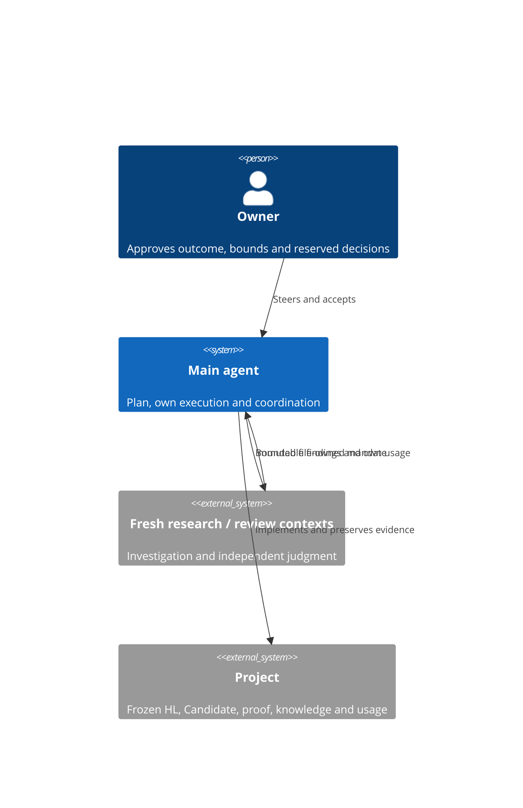

# Full GOAL — До результата

**Enter through /tfw-plan and explicit coordination_mode: goal.** This fourth Full mode uses
approved HL instead of TS. Daily/native goals do not select it. Other modes/contracts retain their routes.

## Agree the goal

Keep the same Plan and master HL: beneficiary, problem, value, constraints, success checks,
freedoms and reservations. Explore the project and existing solutions; render the Working
Backwards result and value flow; compare alternatives, including no change. Challenge both the
owner's proposal and your recommendation. Apply Saint-Exupéry to remove control without losing
meaning or proof. Ask questions that change a decision; reuse settled answers and a proved HL.

A mode-only answer settles mechanics, not the goal. Continue the first unfinished Plan step.
New material uncertainty during execution goes to research or the owner through the same
Coordinator. Research uses fresh subagents for decision-changing gaps, grouped hypotheses,
blind spots and counterexamples. Include how others solve a comparable process, algorithm or UX
in primary internet sources; reuse suitable existing research. Findings changing the promise
require the owner's HL amendment.

### Defaults

| Config key | New-contract default |
|---|---:|
| Execution step limit | 100 |
| Review maximum interval | 10 |

Read tfw.goal from project_config.yaml. Show proposed bounds; owner-approved task values govern.
Preserve project choices and frozen contracts on update. The ordinary HL carries scope/VALUE,
criteria, reservations, its frozen Contract line and positive numeric **Execution step limit**
and **Review maximum interval** headers.
Commit approval before execution. Status carries goal_contract: continuous-v1, goal_step: 0 and,
after approval, goal_ref: task-local-HL-path @ full-reachable-commit. Read that frozen object.
coordination_authority remains the separate launch mandate. Missing, mixed, draft or ambiguous
authority refuses execution; an amendment has a new immutable epoch and preserves prior usage
and step numbers. No TS, phase Coordinators or auxiliary executors are created.

## Execute and recover

End Plan, then the main agent enters Handoff and does all implementation, tests and fixes itself.
Only research and independent review use separate fresh contexts. End an Executor act before
Coordinator routing or rulings; never self-send, self-review or approve an expanded promise.
Choose a sufficient available model and reasoning effort before each permitted launch; record
requested/effective settings, verification and rework. Absence of a mutator is an explicit limit.

First entry is HL_DRAFT/RES → ONB. Record a bound activation in the existing handoff journal,
with the HL epoch and both limits. One **step** is a bounded hypothesis/change → action → oracle
→ outcome and next act. A failed substantive step counts. Tool calls, files, assertions, messages,
waits, native wakeups and compact are not steps. Planning, research, reviews and closure have their
own activity costs; product changes during closure resume execution. Never stretch one step over
the whole task or split it just to manufacture counts. Two unchanged failures require a different
discriminating action or an exact blocker.

Before step N check authority, remaining budget, pending findings/review and cadence. Persist its
start and oracle in ONB/EV before acting. Then persist its result and goal_step=N together before
another step. Use the [existing event grammar](../economics/README.md#goal-attribution), without
a new registry or a file per step. The status is current authority; traces prove its transitions.

At compact/interruption save HL epoch, completed/pending step, latest review and next due,
Candidate/base, open findings, next act and last measured source boundary. A start without result
requires inspecting the actual effect and resolving that same N; never repeat an uncertain effect
automatically. A proved result with stale status permits checked record recovery; status ahead
of proof, gaps or conflicting facts refuse advancement. Compact keeps the same executor and budget.
Actual context loss is disclosed and reconstructed from files under authority, not hidden delegation.

## Independent checkpoints

Review at most the agreed number of completed steps apart, earlier for risk or readiness.
An accepted review at step 7 with interval 10 makes the next deadline 17. Its launch, pending
return or REJECT does not reset that deadline. At readiness request full final review immediately;
one full final review also satisfies a coincident periodic checkpoint.

Pause execution at a fixed reachable Candidate. Append a numbered presentation to RF, naming
review ID, interim/final purpose, completed step, HL epoch, claims, proof and open obligations.
Record that ID's launch in journal before provisioning a fresh reviewer. Every launch has a new ID;
an identical redelivery is a no-op, conflicting payload refuses. The same Candidate can have
different reviews. Supply files, prior findings and evidence, never author conversation, preferred
verdict or solution hints. Use fork_turns:none for native subagents. Unavailable independence
leaves an exact pending act, not self-approval or an unrequested visible chat.

Both purposes use Map → Verify → Judge → REVIEW and VALUE → ASSURANCE → TRACE:
interim checks direction, architecture, delivered claims, evidence and remaining obligations;
planned unfinished work is not itself a defect. Final checks the whole frozen HL in use, including
architecture, compatibility and economics. Preserve stage epochs and return a separate REVIEW
revision for each launch. A changed Candidate requires a new independent judgment.

| Result | Coordinator's next act |
|---|---|
| Interim CONTINUE | Record accepted scope/open obligations; REV → ONB, same executor and counter. No whole-task approval. |
| REVISE within HL | Rule material findings once in live REVIEW; REV → ONB. Main executor fixes within remaining steps; fresh review checks the correction. Blocking findings hold dependent progress. |
| REVISE changing promise or limits | Present the exact amendment to the owner; preserve work, cost and prior epoch. |
| Final APPROVE | KNW: ordinary docs, knowledge/justified-none, trace, economics, cleanup and owner acceptance. |
| REJECT, cap or genuine blocker | Present Candidate, cause, coverage/cost and required decision. No unapproved next step or fabricated completion. |

At a human gate hold dependent work and continue independently authorized work. Step 101 under
a limit of 100 requires owner approval. A limit is not a target to consume.

**Only the owner's explicit instruction pauses, stops or completes GOAL**, including native goal
controls. RF, review, a status question, silence or a budget limit is not that instruction.
Host interruption is an observed fact, not acceptance. Present the full diff, effects, evidence,
uncertainty and economics before acceptance. Merge/publication keep separate authority. Later
material changes receive fresh affected review; do not discard the owner's pending worktree.

## Economics and platform capability

Bind each producer's own source before spending. Use the common collector/reconciliation and
[Codex](../economics/README.md#codex-rollout-recipe),
[Claude Code](../economics/claude-code.md) or [Antigravity](../economics/antigravity.md) recipe.
Verify continuation, independent context and measurement separately on the active surface.
Source parity, a supported sample and a live run are different evidence.

Capture disjoint bounds at activity changes and returns: preparation, research, execution,
correction, interim/final review, actual waiting and closure. Shared ranges remain shared.
Report started/completed steps, presentations, review launches/returns and native wakeups separately;
never derive them from receipt counts. Reconcile overlaps and inclusive parent/child sources once.
Show expected/received/measured producers, model/effort, cutoff, gaps and dated price basis.
Tokens, API equivalent, bills and human time remain distinct; unknown is not zero. Capture final
integration, disclose its finite delivery tail; material reopening gets another bound. No service
or Python requirement is added to ordinary TFW.

## Historical attempt contracts

A frozen HL with only Goal attempt limit and status.goal_attempt retains consecutive charged
outer dispatches, optional main first Executor, fresh Executor after REVISE and fresh full Reviewer
per candidate. Interrupted starts count; compact keeps the attempt. One RF/verdict per attempt
and historical tags keep their meaning. Authority, owner controls and closing obligations remain.
Mixed contracts refuse; only an owner-approved change can adopt new semantics while preserving history.

```mermaid
stateDiagram-v2
  Plan --> Research: material gaps
  Research --> Plan: findings
  Plan --> Execute: frozen HL
  Execute --> Execute: bounded step / compact recovery
  Execute --> Review: due / risk / ready; fixed Candidate
  Review --> Execute: CONTINUE or ruled REVISE; same executor
  Review --> OwnerDecision: changed promise / REJECT
  Execute --> OwnerDecision: cap / blocker
  OwnerDecision --> Execute: authorized continuation
  Review --> Close: final APPROVE
  Close --> Review: material change; fresh reviewer
  Close --> AwaitOwner: docs / knowledge / diff / economics
  AwaitOwner --> [*]: owner accepts and authorizes completion
```

