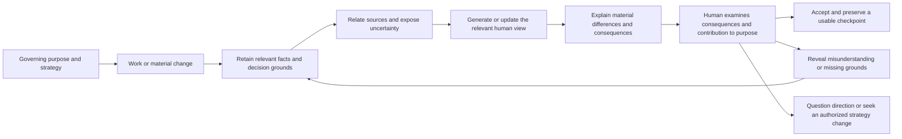

# HL — TFW_20261021-150657_UTW: Understanding Through Work

> **Date**: 2026-10-21
> **Author**: Codex, task Coordinator; owner-direct request by saubakirov
> **Title**: Understanding Through Work
> **Abbreviation**: UTW — approved by the owner on 2026-10-21
> **Status**: Approved for research; task lifecycle is owned by status.md
> **Contract**: 🔒 FROZEN — approved by saubakirov 2026-10-21
> **Baseline**: first `freeze` commit for this task; recover by the convention's commit-subject rule
> **Frozen on approval**: §1 · §3 · §4 · §5 · §6 · §7
> **Free**: §2 · §7.2 · §8 · §9 · §10 · §11
> **Append-only**: §12 Amendment Log
> **Project North Star**: [.tfw/README.md — NS1, NS2, NS3](../../../.tfw/README.md#ns1)
> **Producer unit**: codex:thread:local:01a15de4-49bd-7101-98c7-3be0e89f3288
> **Parent / upward route**: owner:saubakirov; this unit is the task Coordinator
> **Activation source**: owner's direct tfw-plan request, initial coordination selections, and affirmative response to the HL approval request on 2026-10-21 with the research additions incorporated below
> **Originating proposer**: none — owner-direct inception; recommendations below belong to this Coordinator
> **Source inspection epoch**: repository HEAD 082fbb7cff66567cfcc1a880573f5824d4acc1e3 and the selected local sources below, inspected on 2026-10-21

## 1. Vision 🔒 FROZEN

TFW makes human understanding a designed part of work and its acceptance. A responsible person can explain the purpose, important parts and relationships, principal causal path, reasons for consequential decisions, effects of a proposed change and limits of current knowledge at the level needed for their responsibility. They can also inspect why the current work is expected to advance the governing purpose and strategy, and recognize grounds for questioning that connection. This ability remains recoverable as the work changes and can be transferred to another authorized person or agent.

**Impact:** The owner gains an intelligible basis for decisions without having to inspect every implementation detail. Teams preserve the ability to continue their work, and domain-specific tools can serve a shared purpose without turning TFW into an all-purpose analysis platform.

> **Explicitly imagined stakeholder quote:** “I can see how the work fits together, explain what this change affects and why it serves our goal, and tell where we still lack evidence.”

## 2. Current State (As-Is) 🟢 FREE

| Inspected observation | Source | Planning implication |
|---|---|---|
| The owner experiences anxiety when architecture, data, components, knowledge and their connections cannot be understood as a whole. The required level is managerial, not implementation-level mastery. | Owner's inception request, 2026-10-21 | Comprehension and appropriately grounded confidence are intended benefits; neither can be inferred from document existence. |
| The essay explicitly bounds progress by human understanding and warns that Trace can itself become a mechanical formality. | [E2: Keeping pace with understanding](C:/Users/c0rpa/obsidian/c0rp/c0rp/Posts/28-reverse-centaur/07-open-questions-and-education.md) | Generated explanations need an observable human use, not only formal completeness. |
| The essay distinguishes obtaining and checking a result from understanding, explaining, connecting and reusing it. | [E1: When a result becomes knowledge](C:/Users/c0rpa/obsidian/c0rp/c0rp/Posts/28-reverse-centaur/05-terence-tao-and-proof-digestion.md) | Correctness, intelligible presentation and actual comprehension are separate claims. The source is the owner's philosophical argument, not proof of a universal learning effect. |
| TFW philosophy separates philosophy, method and concrete workflow; implementations may vary by setting. Questions about purpose precede an implementation prescription. | [E3: Questions before answers](C:/Users/c0rpa/obsidian/c0rp/c0rp/tfw/06-questions-before-answers.md), [E4: What TFW is](C:/Users/c0rpa/obsidian/c0rp/c0rp/tfw/08-what-is-tfw.md) | The core should carry principles and outcome obligations; domain-specific extraction, views and learning activities remain replaceable. |
| The executive course teaches seeing the whole, setting boundaries and accepting results. Its recall workshop already asks whether pressing Confirm demonstrates understanding. The workshop records 10 questions, 15 points and a 10-minute guide, and explicitly says duration and difficulty were not tested with participants. | [C1: Day 3 lecture](D:/projects/research/kaznpu-ai-lab/courses/tfw/executive/day-3/lecture/slides.md), [C2: Recall workshop](D:/projects/research/kaznpu-ai-lab/courses/tfw/executive/day-3/lecture/recall-workshop.md) | There is existing pedagogical material to reuse; its technical preparation does not establish a validated assessment instrument. |
| Current TFW has a North Star, an architecture/decision index, qualified knowledge records, role-owned traces and visual sections in its artifact templates. | [.tfw/README.md](../../../.tfw/README.md), [KNOWLEDGE.md](../../../KNOWLEDGE.md), [HL template](../../../.tfw/templates/HL.md), [RF template, Diagrams](../../../.tfw/templates/RF.md) | The gap to investigate is how a person reconstructs the whole and follows change across these sources. The presence of these carriers is not evidence that this gap is solved. |
| The owner explicitly requires research into goal setting, focus, strategy/North Star, drift detection, the nature of understanding and a practical form whose benefit justifies attention and token expenditure. TFW already distinguishes conformance from fitness for purpose. | Owner's affirmative HL response and additions, 2026-10-21; [KNOWLEDGE.md, D64](../../../KNOWLEDGE.md) | Investigate how to make the continuing contribution to purpose inspectable during work, building on the existing Purpose Check rather than assuming another registry or gate is needed. |
| Legacy philosophy rows F6/F8/F11 discuss navigable knowledge and agent queryability. Current North Star additionally protects human-governed continuity and bars unsupported comprehension claims. | [knowledge/philosophy.md](../../../knowledge/philosophy.md), [.tfw/README.md — NS1/NS3](../../../.tfw/README.md#ns1) | Preserve these rows as historical context, not proof that agents or humans already understand the current system. This task prioritizes the explicit human need. |

**Beneficiaries and adoption:** Primary beneficiary is the responsible human, initially the owner; secondary beneficiaries are team members, successors and agents. This is one owner's stated need, not evidence of broad market adoption. The foundation must remain useful outside software engineering.

**Iteration 1 observation:** [RES](research/iter1/RES.md) at `9ea3427da7a0f23d2d2894a6c8eb010bada34841` confirms through inspected canonical sources that the existing Purpose Check already examines baseline/North Star relevance, concrete harm, excess, deferral and materiality. The unresolved need is a usable, recoverable view of the relevant whole through change and any additional benefit from examining contribution assumptions during work. The research supplies bounded literature, source observations and constructed counterexamples; it does not establish that the proposed intervention improves human performance, saves upkeep or detects additional drift.

**Bounded external orientation, not a completed RES:** [C4 system context](https://c4model.com/diagrams/system-context) targets the big picture; [Structurizr dynamic views](https://docs.structurizr.com/dsl/cookbook/dynamic-view/) describe a scenario through a model; [OpenAPI](https://spec.openapis.org/oas/v3.2.1.html) describes HTTP interfaces; [Joern CPG](https://docs.joern.io/code-property-graph/) combines program representations; [OpenTelemetry traces](https://opentelemetry.io/docs/concepts/signals/traces/) record request paths. These supply different evidence or presentation layers. Their existence neither selects a stack nor proves end-to-end synchronization or human comprehension.

**Agent-tool boundary:** Current official [Claude Code documentation](https://code.claude.com/docs/en/plugins/code-intelligence) describes installed language-server plugins and an LSP tool. Official [Codex CLI documentation](https://learn.chatgpt.com/docs/codex/cli) describes repository inspection and local tools; this bounded inspection did not establish a universal built-in CPG for Codex. This Coordinator used file reads and textual searches. Agent assistance is not a substitute for an inspectable human view.

**Selected external-source fingerprints (SHA-256):** E1 `4f0be0de10b4c7699ad29084f2e8eaceffb51cf691b06552ae879852258db356`; E2 `d52a4e4a86147b81845c5ac2fc007eb25daa925d44176cafbc789c2b662bf08d`; E3 `43b6ccec49e4f0d8583845433d44d21d09b0c2e0e3465463779da595c08134d6`; E4 `7b030405a1b33346c17d748db387bde7f6cbf4e2342547d50ce52d84663811fd`; C1 `1152d098db91d91288772a668a7006cfc1e2baae66c50874b3585d4c7d8953df`; C2 `4f8c46ae45ce5013cc36b2b69faaa9e2078e2ed3910217842c1c3a58703fe904`. These paths are local inputs, not files authorized for modification or redistribution by this task.

## 3. Target State (To-Be) 🔒 FROZEN

Embed a domain-neutral foundation for understanding in the existing TFW core: define the intended human capability, how work produces and maintains the grounds for it, how consequential changes become intelligible, and how an appropriate human check can reveal a material gap. Implement the resulting foundation in the canonical framework surfaces after research and TS approval; a concept paper alone does not complete this task.

The foundation includes an inspectable connection between the governing purpose/strategy, the expected outcome, the current decision or work, and the evidence or assumptions supporting that connection. It must make material uncertainty, contradiction or possible loss of focus discussable. Research determines an adequate practical form and when it is worth using. A link to a goal, a persuasive narrative or a green alignment score is not proof of contribution. Distinguish drift, deliberate authorized strategy change and insufficient evidence; the system does not choose strategy on the owner's behalf.

The foundation distinguishes three evidence classes: intended/authorized behavior, behavior supported by structural sources, and observed execution in a stated environment. It also distinguishes a representation, the opportunity it gives a person to understand, demonstrated understanding in a specified situation, and the validity of the represented connection to strategy. A generated view must expose relevant provenance, scope, known omissions and currentness rather than imply completeness. Research must define what a proposed comprehension check can and cannot establish; familiarity, recall, fluent explanation and confidence cannot silently stand for transferable understanding.

Domain-specific additions can select questions, sources, representations, change triggers and comprehension activities. A business workflow may use roles, decisions and process maps; software may use interfaces, components, data and traces; personal work may use goals, commitments and knowledge relationships. Research chooses the smallest adequate extension form. This HL does not preselect a plugin SDK, new registry, graph database, daemon, universal diagram set or installation dependency.

**Boundary:** Deliver the shared foundation and a bounded pilot on TFW plus one software process. Produce examples of how domains specialize it, not complete business, software and personal-work products. System-wide employee exams, personnel scoring and a universal training platform are outside this task. Production deployments, paid-service purchases and publication are separate authorizations.

### 3.1 Result Visualization

**Finished-state preview:** At a consequential change, the owner opens a small overview, follows the important path, sees what changed and why, and can inspect the grounds or an explicit unknown. A newcomer can use the same material without reconstructing the originating chat. The pilot must test this intended benefit rather than claim it from a screenshot.

| Before | After | Human value |
|---|---|---|
| The owner reconstructs relationships across files and explanations. | A question-led overview connects the relevant parts to their sources. | Understand the whole at the level of the decision. |
| A diagram's date gives little evidence of what it still matches. | The view names its source version, relevant coverage and changed/unknown relationships. | Know what can be relied upon and what needs checking. |
| A change is delivered as a file diff or a fluent summary. | Material consequences and their rationale are visible alongside the changed view. | Accept, question or stop the change with reasons. |
| Work is progressing, but its contribution to the original goal is asserted rather than examined. | The expected contribution, supporting grounds and reasons to reconsider it are visible at a relevant decision. | Notice possible loss of focus and distinguish it from an intentional change in direction. |

**Illustrative screen; fictional process, not a claim about an inspected platform:**

```text
APPLICATION SUBMISSION                       View: responsible manager

Person -> Receive application -> Check eligibility -> Save -> Notify
                                      |                |
                               Eligibility rules   Application store

WHAT THIS MEANS
Saving an accepted application and delivering its notification are distinct results.
Changing eligibility rules changes which applications can be accepted.
Notification failure/retry behavior still needs separate confirmation.

WHY THIS WORK EXISTS
Purpose: eligible people can successfully submit an application.
Expected contribution: reliable acceptance and confirmation help them finish.
Open question: do failures or added checks prevent eligible people from finishing?
Adding a check may satisfy a local rule while undermining this purpose.

INSPECT A CLAIM
Source and version | intended / structurally supported / observed | limits

TRY A NEW SITUATION
Notifications stop. Which outcome can you still assert, and what must be checked?
```

For TFW, the corresponding questions concern where purpose and authority live, how a finding becomes usable knowledge, which record owns current state, what a changed rule invalidates, and whether an added artifact or gate actually serves human-governed continuity. The pilot should expose a case where procedural progress and contribution to purpose diverge. It is a view of the work, not merely a role delivery diagram.

### 3.2 Value Flow



## 4. Phases 🔒 FROZEN

One bounded task-level delivery cycle: **framework foundation and its pilot evidence**. No separate phase Coordinator is justified at inception. Research precedes its TS; implementation includes the canonical foundation, the minimal domain-specialization boundary and both selected pilots. If research reveals a materially larger or incompatible outcome, return the scope decision before decomposing it into phases.

The accepted output consists of: an implemented core principle and workflow obligations in their existing owning locations; an explicit, proportionate way for domains to specialize those obligations; and a source-bound pilot result that reports benefits, failures, maintenance effort and the next adoption decision. Research must supply a plausible first implementation and extension path, including what gets produced, from which existing sources, at which material moments, by whom, and at what recurring attention/token/maintenance cost. This is a feasibility requirement, not authorization to implement during research. The TS selects exact paths, measures and checks after research. No permanent tests are added without the owner's prior agreement; existing required repository checks remain applicable.

### 4.1 Coordination Selection 🔒 FROZEN

| Activation source | Accountable owner | Task Coordinator unit | Phase Coordinator rule | Mandate scope / role reach | Upward route | Dialogue | Reporting | Reservations / controls | Amendment authority | Immutable epoch |
|---|---|---|---|---|---|---|---|---|---|---|
| Owner-direct Plan; owner-selected delegated operation effective after this HL freeze | saubakirov | codex:thread:local:01a15de4-49bd-7101-98c7-3be0e89f3288 | None for the single delivery cycle | This task only: create distinct Researcher, Executor and independent Reviewer chats; send permitted vertical commands; advance ready authorized returns and corrections | owner:saubakirov | tfw-gates-only | native-gates | Owner approves HL, exact TS/budget, material reserved changes and final acceptance; no external distribution grant | None; frozen-scope and authority changes return to owner | This approved HL's immutable freeze, resolved through status.md; operational addresses and dispatches remain in task control records |

**Actual human selections:** On 2026-10-21 the owner selected Coordinator-created separate role chats within agreed bounds, the configured model with task-specific reasoning effort, the concept-and-pilot scope, and the title/ABBR. The owner clarified that this task must embed the foundation and principles in the framework, with domain-specific details potentially supplied by extensions. In response to the subsequent exact HL approval request, the owner answered affirmatively and added strategy/focus, the nature and evidence of understanding, and practical cost as research requirements. These additions are incorporated before the first freeze; implementation and its exact TS/budget remain reserved.

**Current capability:** provision / addressed send / wait-readback / title-readback are all native via the exposed Codex tools. Exact title `PLAN · UTW` was written and read back for this unit. The task-only section `TFW · UTW` was created and move receipt returned; exact membership readback remains to be reconciled because the section currently shows a client handle. Capability is not a claim of end-to-end reliability.

**Launch policy and isolation:** Omit `model` on new role creation under the owner's selected configured-model policy; choose supported reasoning effort with a concrete reason at each launch. Future effective settings and addresses remain unobserved. New roles receive only `/tfw-* TFW_20261021-150657_UTW`. Mutating roles use separate worktrees; review receives a fixed reachable Candidate. No subagent substitutes for a TFW role. Required human decisions and evidence remain gates. Safe closure includes independent review, owner acceptance, applicable docs/knowledge effects, task changelog and disposition of task-owned resources.

## 5. Definition of Done (DoD) 🔒 FROZEN

- ✅ 1. The canonical TFW foundation states the human-understanding outcome, responsibility-sensitive level of detail, and relationship to purpose, evidence, acceptance and continuation; it remains domain-neutral. It supports examining the continuing contribution to strategy/North Star and surfacing material grounds to question it, using existing purpose and decision owners.
- ✅ 2. Existing workflow/artifact owners produce and refresh the necessary grounds and explanations at material points of work. Currentness, scope, source relationships and uncertainty have a clear treatment without a second authority for facts or state.
- ✅ 3. The domain-specialization boundary is usable and illustrated for business, software and personal work, while the core requires no universal analyzer, diagram set, graph service or exam system.
- ✅ 4. The TFW pilot and one selected software process demonstrate source-to-view traceability and response to change, including a material unknown or mismatch rather than only a successful path. Across the pilots, include a case of apparent local progress with questionable contribution to the governing goal, and distinguish it from an authorized change of strategy or an unresolved assumption. Report explicitly what the cases do not establish for other domains, stacks or distributed systems.
- ✅ 5. An actual human uses the pilot material to explain a new scenario or consequential change; report correctness/omissions, effort, assistance and subjective clarity separately. State the operational meaning and limitations of the observed understanding, including what was possible with the view and what was demonstrated without assistance if tested. Compare with an appropriate simpler baseline, selected before the trial. No unobserved comprehension or universal efficacy claim is accepted.
- ✅ 6. Report initial and recurring human attention, model/tool usage and maintenance through a real or explicitly controlled change, separating measured values from estimates and unavailable data. Relate these costs to the observed decision benefit and specify the smallest viable core and extension path, including a simplify/omit decision where warranted. Independent review verifies scope, source fidelity and evidence; the owner accepts the resulting framework changes.

## 6. Definition of Failure (DoF) 🔒 FROZEN

- ❌ 1. The result adds documentation or attractive diagrams while leaving the owner unable to explain relevant behavior and consequences; confidence alone is treated as comprehension.
- ❌ 2. Generated/inferred relations, intended rules and observed execution are silently merged, or stale/incomplete information is presented as current and exhaustive.
- ❌ 3. Core TFW becomes software-specific, requires a universal runtime/platform, duplicates authoritative facts, or mandates every representation for every task.
- ❌ 4. A fresh rendering is counted as evidence of semantic currentness; a technically checked quiz is counted as validated learning; agent statements are counted as human understanding.
- ❌ 5. Delivery stops at a concept paper without embedding the accepted foundation in the framework, or expands into complete domain products instead of the authorized foundation and pilots.
- ❌ 6. A goal reference or automatic alignment label is treated as evidence that work advances strategy; the mechanism cannot expose contrary grounds, or silently redefines the goal to justify activity.

**On failure:** Return the exact failed value claim and evidence to the Coordinator. Revise the selected approach or route an HL amendment where the frozen outcome changes. Do not conceal failure with additional artifacts, a deferred universal platform or invented user results.

## 7. Principles 🔒 FROZEN

1. **Understanding serves responsibility.** The human needs enough of the purpose, causal structure, dependencies and uncertainty to make their decision; exhaustive knowledge of implementation is not the default requirement.
2. **Human pace governs consequential commitment.** Agents may investigate and prepare rapidly; material acceptance and continued commitment must preserve the responsible human's ability to understand consequences. Do not turn this into a pause after every mechanical action.
3. **Produce understanding through work.** Preserve grounds when decisions and changes occur, and reuse them for appropriate views and discussions instead of relying on a separate retrospective documentation campaign.
4. **One authority, multiple views.** A view derives from or points to the owning sources. Domain vocabulary and abstraction may be curated; the map cannot silently become a competing operational truth.
5. **Expose epistemic limits.** Show what is intended, extracted, observed, inferred, changed or unknown at a granularity that matters to the reader. A source hash detects byte changes, not semantic truth.
6. **Evaluate use, not artifact count.** Seek evidence through an appropriate scenario, explanation or decision; research must establish the scope and limitations of that evidence. Human confidence, recall, task correctness, assistance and transferable understanding remain distinct claims.
7. **Proportionality and portability.** Use the least structure that preserves meaning, evidence and continuation. Let domains specialize the foundation without making one vendor, graph, notation or runtime mandatory.
8. **Make contribution to purpose contestable.** Expose the expected connection to the governing goal and the assumptions, tradeoffs or observations that could defeat it. Surface possible drift for the authorized decision-maker; legitimate strategy change is an explicit decision, not an automatic failure or a silent rewrite.

### 7.2 Knowledge Citations 🟢 FREE

| # | Source | Item | How it applies |
|---|---|---|---|
| P0 | [.tfw/README.md](../../../.tfw/README.md#ns1) | NS1; NS2.2/4/7; NS3 | Protect intelligible human-governed continuation; reject a documentation factory, unsupported understanding claims and unnecessary machinery. |
| P1 | [.tfw/README.md](../../../.tfw/README.md#methodology-values) | Methodology values; Success Criteria 1–4 | Distinguish claims from evidence, retain portability, and make results inspectable and usable for continuation. Separate from P0 purpose. |
| P2 | [knowledge/philosophy.md](../../../knowledge/philosophy.md) | F6/F8/F11, historical framing; F13 domain breadth; F32/F45 preservation and subtraction | Treat prior agent-queryability language as context, not proof of human understanding. Current owner direction and NS1 govern the proposed human outcome; do not create a parallel documentation institution. |
| P3 | [KNOWLEDGE.md](../../../KNOWLEDGE.md) | Architecture Map; D34/D39 historical visual/navigation design; D68/D82 task-local authority; [TKL-20260913-01](../../../knowledge/records/TKL-20260913-01.md) scoped knowledge successor | Reuse current sources and role-owned handovers. Keep generated views disposable and independent of ordinary lifecycle authority; preserve incoming-relation checks. |
| P4 | [conventions.md](../../../.tfw/conventions.md) | HL Contract; Design Rules; Anti-patterns; Current knowledge use | Freeze only approved outcomes, use progressive disclosure, preserve source meanings and role ownership, and avoid implementation during Plan. |
| P5–P7 | Current owner request and clarification; E1–E4 and C1–C2 in §2 | Human pace, managerial understanding, domain specialization and actual comprehension | These named sources supply the relevant stakeholder/philosophical/pedagogical context. No additional unrelated topic/history corpus is needed. |
| Task research | [Iteration 1 RES](research/iter1/RES.md) at `9ea3427da7a0f23d2d2894a6c8eb010bada34841`, with its exact stage/source scopes | Gather G1–G7; Extract E1–E6; Challenge CH1–CH5 | Separate representation, elicited action, assistance and observed capability; distinguish semantic applicability from regenerated bytes and expected from observed contribution. These are bounded research grounds, not qualified universal project facts; abstract-only sources and domain-transfer limits remain as recorded. |

The full P0–P4 scan and a relevant P5–P7 search were performed. Incoming record searches covered the cited legacy philosophy identities and D37/D82/TKL knowledge relations. The current knowledge-use and no-required-runtime rules are read directly from their governing sources; historical success/novelty claims are not adopted as new evidence.

## 8. Dependencies 🟢 FREE

| Dependency | Status |
|---|---|
| Owner-approved title, operating arrangement and foundation/pilot scope | Confirmed on 2026-10-21; subsequent affirmative HL response includes the strategy/understanding/cost additions |
| Exact HL approval and immutable freeze before research | Owner approval recorded; first freeze is the immutable baseline referenced by status.md before dispatch |
| Separate Researcher and later Executor/Reviewer | The same Researcher returned iteration 1 at `9ea3427da7a0f23d2d2894a6c8eb010bada34841`; its validated own numeric return observes gpt-6-astra/high. Retain its isolated worktree for iteration 2. Executor/Reviewer are not yet launched. |
| Software-process selection and bounded access | Select the local documentation generation/build path for iteration-2 research preparation only. Final pilot selection belongs to TS approval; the path does not represent HTTP/database or distributed-service behavior, and static inspection is not execution evidence. |
| Human pilot participant and executable trial | Owner is intended first participant; trial scope and timing belong to TS approval, and actual use remains required |
| Selected essays/course accessible on this host | Inspected; fingerprints in §2; revalidate changed sources and avoid copying the private corpus |
| Existing carriers, source authority and semantic refresh owner | Existing HL/ONB/RF/EV and currentness ownership are feasible starting points. Iteration 2 must identify exact sources, producing/refresh responsibility and material triggers for the two cases. Extractor/runtime dependencies remain conditional; no new platform requirement is established. |

## 9. Risks 🟢 FREE

| Risk | Probability | Impact | Mitigation |
|---|---|---|---|
| A plausible map creates misplaced confidence | Unmeasured | High | Test an unfamiliar scenario and disclose missing grounds; separate comfort from correct prediction. |
| Views reproduce code detail rather than the decision-level model | Unmeasured | High | Start from the reader's questions and compare a simpler explanation baseline. |
| Maintaining abstractions costs more than the benefit, or fresh bytes conceal stale meaning | Unmeasured | High | Track upkeep for bounded changes and relevant external assumptions; distinguish material meaning changes from harmless edits; permit on-demand reconstruction or simpler material. |
| Automation misses dynamic/configuration/data relationships | Unmeasured | High | Bound extraction claims and combine appropriate sources; never infer absence from missing instrumentation. |
| The foundation grows into a new bureaucracy or platform | Unmeasured | High | Use existing owning sections, materiality and an optional domain boundary; remove unsupported requirements. |
| Two pilots are generalized to every domain | Unmeasured | Medium | Publish observed scope, counterexamples and untested transfer explicitly. |
| Goal links or scores rationalize activity while hiding strategic drift | Unmeasured | High | Require a contestable contribution claim; examine contrary evidence and distinguish a change in strategy from deviation. |
| Assessment rewards rehearsed wording, assistance or practice from the assessment itself | Unmeasured | High | Define the capability and assistance condition; separate initial/later exposure and observed response; use independently grounded criteria and disclose transfer limits. |
| Generated explanation and answer criteria repeat the same consequential error | Unmeasured | High | Check the governing source independently of the generated material and accept a grounded challenge to the answer criteria; independent role identity alone is insufficient. |
| A locally correct short account hides the relevant whole | Unmeasured | High | Require purpose, boundary, important relationships and the main path; compare adequate forms, not brevity or tooling count. |
| A compulsory scenario obstructs access to explanation | Unmeasured | High | Offer adequate orientation and voluntary scenario-led help; needing context is not evidence of incompetence. |
| Apparent drift is authorized adaptation or delayed/ambiguous evidence | Unmeasured | High | Compare against effective authority, distinguish expected/observed contribution and uncertainty, and test both missed divergence and false alarms. |

## 10. RESEARCH Case 🟢 FREE

### Blind Spots

The smallest sufficient human model, the meaning and limits of demonstrated understanding, extraction coverage, currentness mechanisms and ongoing human cost are unresolved. Research must distinguish an external representation from a person's ability to explain, anticipate consequences, transfer knowledge or act appropriately; no one observation is assumed to establish all of these. It must also investigate how goals, strategy and North Star can be related to current work without confusing traceability with causal contribution, or drift with authorized adaptation. It is unknown whether a new extension mechanism is necessary or existing skills and ordinary files suffice. A call graph cannot by itself establish business meaning, decision grounds, strategic value or every runtime path.

### Hypotheses

| # | Decision-changing hypothesis | Plausible false case and consequence | Status |
|---|---|---|---|
| H1 | Question-led representations help a responsible person reason about a new scenario; a proportionate check can produce interpretable evidence of this capability beyond recall or confidence. | The check measures rehearsal/assistance, confidence rises without better reasoning, or a simpler explanation performs as well. Revise the capability claim and check; do not mandate diagrams or examinations. | Product claim open after iteration 1; format, assistance and practice distinctions established as evaluation constraints, not efficacy |
| H2 | Capturing grounds during work and deriving relevant views reduces currentness/maintenance burden enough to justify its integration. | Important abstractions need costly manual repair or source changes do not identify semantic staleness. Prefer bounded on-demand reconstruction or explicitly owned concise documentation. | Cost advantage open; regenerated bytes alone are not sufficient evidence of semantic applicability |
| H3 | A small domain-neutral foundation plus optional specialization supports the two pilots using existing source and presentation tools. | Domain semantics require incompatible obligations or substantial infrastructure. Narrow the foundation and isolate the uncovered domain work; build only a demonstrated missing constituent. | Expressible using existing carriers; practical sufficiency and portability remain open |
| H4 | Making a work-to-outcome-to-purpose contribution claim and its defeaters inspectable at material changes helps notice loss of focus beyond the existing Purpose Check, at proportionate cost. | The representation only restates goals, misses real divergence or repeatedly flags legitimate adaptation; a simple question at the existing checkpoint works as well. Reuse or improve that checkpoint and omit unsupported scoring, maps or monitoring. | Incremental benefit open; current Purpose Check is a substantial baseline, and false alarms need examination |

### Risks of Not Researching

Selecting a diagram generator first could freeze a technical answer to an untested human problem. Claiming automatic currentness could create another trusted but stale document. Formalizing exams too early could measure recall of vocabulary while missing the ability to reason about change.

### Proposed RESEARCH Focus

The configured minimum is two research iterations; prepare `research/iterations.yaml` only after HL approval and before each actual dispatch.

1. **Initial iteration:** establish decision-relevant prior art and distinctions for human understanding, representations and assessment; goal setting, strategy/North Star and detecting drift; and source-bound views produced through work. Compare established approaches using primary sources, including contrary findings and limitations. Separate applicable evidence from analogy, vendor claims and proposed hypotheses. Give a concrete minimal core/domain form and explain what it would produce, when, from what sources and with what cost drivers. Challenge the need for a new platform, mandatory diagram, score or exam.
2. **Follow-up iteration:** challenge the surviving recommendation against one TFW path and the selected software-process candidate, including semantic currentness, a potential strategic divergence, an authorized change in direction, uncertainty, comprehension-check validity and a simpler baseline. Refine the executable pilot, extension path, acceptance evidence and cost/stop conditions. Use iteration 1's gaps; do not repeat a broad catalogue or claim human trial results before they exist.

Research should answer three integrated questions: **(1)** what capability must the human gain and what evidence can support a bounded claim that they gained it; **(2)** what connects present work to the intended outcome and strategy, and what observable change would put that connection in doubt; **(3)** what is the least costly practical form that creates and maintains both kinds of support within ordinary work? Candidate searches may span cognitive/learning research, goal-oriented modelling and strategy evaluation, and architecture/process/knowledge tooling; these are search directions, not selected solutions.

These are research questions and expected decisions, not permission for the Researcher to implement the framework or author TS.

**Iteration 1 mode ruling, 2026-10-21 — task Coordinator:** Select **deep**. The Researcher's request in `research/iter1/0_mode.md @ 54c84bbf99b746fe9cb20297444f9541d69cb66b` and its committed status were read and checked against the current freeze and initial selection. The recommendation for focused is a serious lower-cost option, but that mode is designed for a known topic and low uncertainty. This iteration instead has unresolved constructs and architectural consequences; deep's required hypothesis challenge and active search for counter-evidence fit H1/H4 and the owner's explicit additions. This does not assert that deeper work will necessarily be more valuable. Keep configured query/file/question limits and the maximum of three stage passes; stop once the decision-relevant gap and mode checkpoints are satisfied. Additional passes must name the unresolved decision they can change. Two iterations remain the current ceiling; a broad tool catalogue or exhaustive taxonomy is not an outcome. The same Researcher may now load deep and prepare Briefing, then return its existing stage gate to this Coordinator. No implementation, changed goal or TS/budget approval is granted.

**Iteration 1 disposition, 2026-10-21:** Accept the complete RES as bounded research and apply its R1–R5 to free sections only. No amendment is proposed or needed for those refinements. C1* is the provisional adequate-overview/change-account candidate, not a prose-only or shortest-text requirement. A relation table, labeled path or diagram may be necessary even in that baseline. C2* adds maintained/derived representation for a named difficulty; C3* is optional scenario-led help with explanation available; C4* is a conditional structural evidence feed. None is an empirically selected winner. Keep B0/current practice as a serious comparator, the two pilots and the actual-human/cost evidence obligations.

**Iteration 2 scope and mode decision:** Select **focused** for the same Researcher. Iteration 1 has supplied the conceptual distinctions and competing forms; now the decision concerns bounded case design and practical integration. Use one pass per stage under the configured limits; reuse the inspected evidence and seek new sources only for a named decision-changing gap. The earlier deep mode remains the correct historical choice for iteration 1. Ordinary stage gates stay in force; this is the explicit mode ruling to read at the iteration-2 mode checkpoint, not a new permission request to the owner.

The two research cases are **(a)** one consequential TFW task change from approved purpose through result acceptance and reusable knowledge, showing authority, sources, main relationships and uncertainty, and **(b)** the inspected documentation generation/build path with its source/output/configuration boundary. Produce source-bound illustrative overviews and change accounts inside the research artifacts, not production framework edits or executed-pilot claims. The software case is selected for this investigation; its final use as the pilot remains subject to TS approval.

Resolve three integrated decisions: **(1)** what adequate whole/change view each case needs, which existing location and author supply it, and whether C2* adds a named benefit over adequate C1*; **(2)** how purpose divergence, authorized strategy change and insufficient evidence are distinguished against the real Purpose Check, with independently grounded human-response criteria and equivalent content/help conditions; **(3)** how a material semantic/context change and a nonmaterial edit affect refresh, evidence reuse and preparation/use/update measurements, including simplify/omit conditions. Carry all four RES open threads within these decisions. Return concrete integration candidates and an executable pilot proposal with unresolved owner choices; do not repeat the broad literature/tool catalogue or claim actual human benefit. A third iteration is not preauthorized.

**Iteration 2 resource selection:** Preserve the same configured model by omitting a model override; its iteration-1 numeric return observed gpt-6-astra/high. Request **medium** reasoning effort for this bounded continuation: the sources, distinctions and rejected shortcuts are now explicit, and the remaining work is concrete application and comparison. High remains a possible response to a specific unresolved reasoning problem, not the automatic setting. This selection is a cost/capability judgment, not measured superiority of medium; effective settings remain unobserved until the next returned evidence. It does not relax evidence, source fidelity or stage requirements.

### Why Not Just...?

| Approach | Value | Adoption / operating burden | Risks / tradeoffs | Decision and reason |
|---|---|---|---|---|
| Human-curated concise overview and walkthrough | Fast start; meaningful domain language | Low tooling setup; recurring human review | Freshness depends on an owner; may still be the cheapest sufficient method | Serious baseline, not dismissed |
| Automatic structural/runtime extraction | Repeatable technical relationships and observed paths | Analyzer/instrumentation integration; stack-dependent coverage | Detail overload, incomplete dynamic coverage, missing rationale | Useful source layer, insufficient alone for the stated human goal |
| Source-bound views plus decision/change explanations within work | Connect actual grounds with a useful human abstraction | Initial design and selective integration; continuing semantic curation | Could become a second maintenance product or create false confidence | Coordinator recommendation to test; keep only evidence-supported constituents |

**Leave unchanged:** The owner must continue reconstructing the whole from scattered sources and live explanations, while accumulated documents may give an unjustified impression of available knowledge.

**Critical challenge:** The proposed foundation could reproduce the very problem it addresses by adding more artifacts and gates. If an existing concise explanation, purpose question and occasional walkthrough provide the same benefit at lower cost, prefer them. Passing a schema, generating a diagram, linking a goal or receiving a fluent answer cannot decide H1–H4.

**Cost boundary:** No implementation estimate or paid tool choice is approved. Research must expose setup effort, recurring semantic maintenance, human attention, model tokens/cost where supportable, tool dependencies and the work displaced or decisions improved before the exact TS budget is set. Compare unchanged, concise on-demand and more automated forms. Propose conditions for using, simplifying or omitting the mechanism; continuous generation is not the default. Preserve the configured 50-file/5,000-LOC decomposition prompts and owner escalation rules; they are not the planned denominator.

## 11. Strategic Insights (Planning) 🟢 FREE

| # | Insight | Category | Source |
|---|---|---|---|
| S1 | The owner wants calm grounded in a usable understanding of the whole, and distinguishes this from making material convenient for an agent. | stakeholder | Owner's inception request, 2026-10-21 |
| S2 | Human pace is a design requirement: the work should create its own understandable account at managerial level. | philosophy | Owner's inception request; E2 |
| S3 | Maintaining detached documentation has repeatedly failed the owner's experience; the desired mechanism should arise during ordinary work. | process | Owner's inception request; a reported experience, not a measured universal failure rate |
| S4 | Exams and knowledge sessions are exploratory ideas, explicitly secondary to the overall concept. | stakeholder | Owner's inception request |
| S5 | This task must embed the foundation in the framework while allowing business, software and personal-work specialization; it cannot solve every domain at once. | constraint | Owner's scope clarification after title/pilot selection, 2026-10-21 |
| S6 | Understanding how work operates is insufficient without grounds for seeing whether it still serves the governing purpose, focus and strategy/North Star. | purpose | Owner's affirmative HL response and research additions, 2026-10-21 |
| S7 | The opportunity to understand is required; actual human understanding and its measurement remain research questions. Practical realization and recurring attention/token costs must be examined from the start. | evidence / economics | Same owner response; no assessment instrument or universal score selected |

## 12. Amendment Log 🟢 APPEND-ONLY

**No amendments.** This document is still a draft. The owner's foundation clarification is incorporated before the first approval.

### Material handover at this return

Producer: task Coordinator `codex:thread:local:01a15de4-49bd-7101-98c7-3be0e89f3288`, on 2026-10-21. Inspected scope: ordered Plan rules, selected P0–P4/relevant knowledge, named essays/course passages, and bounded official tool documentation. Material result: foundation-first task framing, human outcome distinct from source coverage and diagram generation, optional domain specialization, two pilots and falsifiable H1–H3. No independent research synthesis, implementation or human comprehension trial has occurred.

Recipient: owner saubakirov for the exact draft decision. Continuation: resolve requested changes or approve this HL, commit its freeze, then prepare the first research iteration and activate a distinct Researcher with `/tfw-research TFW_20261021-150657_UTW`. The task Coordinator retains purpose, authority and reserved decisions. Source/epoch uncertainty and software pilot selection remain explicit above.

Economic source binding: own Codex rollout `01a15de4-49bd-7101-98c7-3be0e89f3288`, local path `E:/Users/c0rpa/.codex/sessions/2026/10/21/rollout-2026-10-21T14-56-44-01a15de4-49bd-7101-98c7-3be0e89f3288.jsonl`; `session_meta.id` and `session_id` both match this unit. Project label is the configured `my-project`; task is this UTW ID; phase is absent; role is coordinator; owner is saubakirov; reporting timezone is `+05:00`. No other unit has been dispatched.

**Interim own-return capture:** [validated numeric bytes](economics/roles/e007ab6c2e6e3b30d7177a25acca84fa750b06e64454c5f635f750e87f4b282a.jsonl), revision 1, SHA-256 `e007ab6c2e6e3b30d7177a25acca84fa750b06e64454c5f635f750e87f4b282a`, source-line range `[0, 298)`, cutoff `2026-10-21T10:14:55.949309+00:00`. The selected prefix is complete; the turn and task remain open. Thirty-seven unique native response records reconcile to 4,938,614 provider-accounted tokens: 219,154 fresh input, 4,689,152 cached input and 30,308 output; reasoning is an output subset, never added again. The alternate cumulative token-count stream reports 4,725,488; the collector selected the response stream reconciled to its native thread total and preserved this discrepancy. Completed-turn duration is unavailable. These are repeated request-accounting totals, not unique document words, subscription charges or proof of value. Expected/received producers: this Coordinator only, one validated contribution. Final delivery, receipt integration and cleanup form the disclosed excluded tail; a substantive continuation needs a new bound. No money estimate is asserted.

### Owner approval and research additions — 2026-10-21

Source: the accountable owner's affirmative response to this Coordinator's exact HL approval request in the same native unit, followed by explicit additions concerning goal setting, focus, strategy/North Star, actual understanding and practical realization/cost. The Coordinator resolves that response as approval to proceed with those additions. They are incorporated in the initial baseline, not a later amendment. The initial separate-role selection recorded in `journal/20261021-151357__coordination_selected__5cca.md` becomes effective after this freeze; exact TS/budget, implementation acceptance and changes outside that mandate remain owner-reserved.

Material addition: H4 examines contribution to purpose and drift; H1 now explicitly examines what evidence can support a bounded comprehension claim. Target, pilot criteria and principles distinguish representation, opportunity, demonstrated capability and justified strategic contribution. Research must compare a simpler baseline and expose initial and recurring human/model/maintenance cost, a plausible implementation and extension path, and conditions for simplifying or omitting a mechanism. These are required investigations, not findings or selected instruments.

Recipient: the distinct Researcher selected by the task Coordinator. Continuation: read the committed current status, dispatch and first pending iteration; run the research workflow and return stage gates and durable findings only to this Coordinator. The existing North Star and Purpose Check are starting points to inspect, not assumed solutions. No RES, implementation or human-trial evidence is claimed by this approval record.

### Research launch return — 2026-10-21

Producer: the same task Coordinator. Governing freeze: `30c07f6d690482c8fdfeeecba29999089a3bcd87`; first research control and dispatch: `68d5ebabca9935911fcc2e20b5f582d9740d989a`; exact Researcher receipt: `journal/20261021-183647__dispatch__f3b2.md` at `6b149e65` (resolve its full Git object before a dependent act). Native child: `codex:thread:local:01a15ead-17fe-77d0-ab5c-42f6122cc8d3`. The first cursor-based readback observed an active turn receiving the exact research command; a later readback remained active. This is delivery/progress evidence, not an accepted research result. Requested model remains configured/omitted and effort high; effective settings are unobserved. Do not derive a result from another unit's unfinished commentary.

Validated scope at this return: all frozen sections still match the first freeze; task authority, five current events and their local references validate; the complete first pending iteration covers H1-H4 and the initial ceiling is two iterations. Ordinary research gates return to this Coordinator under the existing mandate. The next substantive output is the Researcher's durable stage/RES evidence; final framework implementation still requires the owner's exact TS/budget approval.

**Own economic continuation capture:** [validated revision 2](economics/roles/16cbcc89805caa11f5ee68f5ea1c252de23800c34f1fac4550c215ee6ea5251a.jsonl), SHA-256 `16cbcc89805caa11f5ee68f5ea1c252de23800c34f1fac4550c215ee6ea5251a`, range `[0, 505)`, cutoff `2026-10-21T13:41:10.000799+00:00`. This is a verified covering successor of the preserved revision 1, not an additive second copy of its usage. The selected source prefix is complete; the current turn and task remain open. The collector preserved the discrepant cumulative counter and chose the unique-response stream reconciled to its native thread total; neither stream is added to the other. Receipt integration, final validation/commit and delivery are the disclosed excluded tail; later substantive coordination requires a new bound. No currency or value claim is made. One own producer return is received; the Researcher is newly dispatched and has no completed return due at this checkpoint. Its source is neither inspected nor imputed as zero.

### Mode-gate continuation return — 2026-10-21

The Researcher's ordinary mode gate arrived after revision 2's cutoff. This Coordinator read the exact returned `0_mode.md` and its committed status at `54c84bbf99b746fe9cb20297444f9541d69cb66b`, verified activation and isolation, and ruled **deep** with a bounded-cost rationale in free §10. That ruling is committed at `f199d0b73474c6e6d8390a588fa56bd66b1a5cb4`. The exact continuation command and immutable HL reference were delivered to the same Researcher by native addressed send. Recipient/next act: that Researcher prepares Briefing and returns its next existing stage gate; this Coordinator handles it within the frozen mandate. No completed stage/RES or human result is accepted here.

To cover this substantive continuation, [validated revision 3](economics/roles/73e22e979bcd2784918029f6ca787f20ad109abeac91235cb382ae8883db21c2.jsonl), SHA-256 `73e22e979bcd2784918029f6ca787f20ad109abeac91235cb382ae8883db21c2`, covers `[0, 565)` at `2026-10-21T13:45:04.183748+00:00` and verifies revision 2 as its predecessor. Preserve earlier bytes but select the covering successor, never add overlapping revisions. Own source/unit binding is unchanged. The source prefix is complete while the turn/task remain open; only this receipt's integration, final checks/commit, temporary-file cleanup and owner delivery are excluded. The Researcher's ordinary gate binds its own source and explicitly owes measurement at its final RES return; that source remains outside this Coordinator's inspection. The role's worktree is retained for its authorized continuation. No price, completed task cost or product-value claim is inferred.

---

*HL — TFW_20261021-150657_UTW: Understanding Through Work | 2026-10-21*
