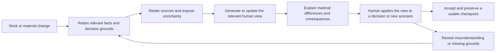

# HL — TFW_20261021-150657_UTW: Understanding Through Work

> **Date**: 2026-10-21
> **Author**: Codex, task Coordinator; owner-direct request by saubakirov
> **Title**: Understanding Through Work
> **Abbreviation**: UTW — approved by the owner on 2026-10-21
> **Status**: 📝 HL_DRAFT — awaiting owner review
> **Contract**: 📝 DRAFT — not yet approved
> **Frozen on approval**: §1 · §3 · §4 · §5 · §6 · §7
> **Free**: §2 · §7.2 · §8 · §9 · §10 · §11
> **Append-only**: §12 Amendment Log
> **Project North Star**: [.tfw/README.md — NS1, NS2, NS3](../../../.tfw/README.md#ns1)
> **Producer unit**: codex:thread:local:01a15de4-49bd-7101-98c7-3be0e89f3288
> **Parent / upward route**: owner:saubakirov; this unit is the task Coordinator
> **Activation source**: owner's direct tfw-plan request in this chat; subsequent answers approve the title, initial operating arrangement and bounded scope, not this HL
> **Originating proposer**: none — owner-direct inception; recommendations below belong to this Coordinator
> **Source inspection epoch**: repository HEAD 082fbb7cff66567cfcc1a880573f5824d4acc1e3 and the selected local sources below, inspected on 2026-10-21

## 1. Vision 🔒 FROZEN

TFW makes human understanding a designed part of work and its acceptance. A responsible person can explain the purpose, important parts and relationships, principal causal path, reasons for consequential decisions, effects of a proposed change and limits of current knowledge at the level needed for their responsibility. This ability remains recoverable as the work changes and can be transferred to another authorized person or agent.

**Impact:** The owner gains an intelligible basis for decisions without having to inspect every implementation detail. Teams preserve the ability to continue their work, and domain-specific tools can serve a shared purpose without turning TFW into an all-purpose analysis platform.

> **Explicitly imagined stakeholder quote:** “I can see how the work fits together, explain what this change affects, and tell where we still lack evidence.”

## 2. Current State (As-Is) 🟢 FREE

| Inspected observation | Source | Planning implication |
|---|---|---|
| The owner experiences anxiety when architecture, data, components, knowledge and their connections cannot be understood as a whole. The required level is managerial, not implementation-level mastery. | Owner's inception request, 2026-10-21 | Comprehension and appropriately grounded confidence are intended benefits; neither can be inferred from document existence. |
| The essay explicitly bounds progress by human understanding and warns that Trace can itself become a mechanical formality. | [E2: Keeping pace with understanding](C:/Users/c0rpa/obsidian/c0rp/c0rp/Posts/28-reverse-centaur/07-open-questions-and-education.md) | Generated explanations need an observable human use, not only formal completeness. |
| The essay distinguishes obtaining and checking a result from understanding, explaining, connecting and reusing it. | [E1: When a result becomes knowledge](C:/Users/c0rpa/obsidian/c0rp/c0rp/Posts/28-reverse-centaur/05-terence-tao-and-proof-digestion.md) | Correctness, intelligible presentation and actual comprehension are separate claims. The source is the owner's philosophical argument, not proof of a universal learning effect. |
| TFW philosophy separates philosophy, method and concrete workflow; implementations may vary by setting. Questions about purpose precede an implementation prescription. | [E3: Questions before answers](C:/Users/c0rpa/obsidian/c0rp/c0rp/tfw/06-questions-before-answers.md), [E4: What TFW is](C:/Users/c0rpa/obsidian/c0rp/c0rp/tfw/08-what-is-tfw.md) | The core should carry principles and outcome obligations; domain-specific extraction, views and learning activities remain replaceable. |
| The executive course teaches seeing the whole, setting boundaries and accepting results. Its recall workshop already asks whether pressing Confirm demonstrates understanding. The workshop records 10 questions, 15 points and a 10-minute guide, and explicitly says duration and difficulty were not tested with participants. | [C1: Day 3 lecture](D:/projects/research/kaznpu-ai-lab/courses/tfw/executive/day-3/lecture/slides.md), [C2: Recall workshop](D:/projects/research/kaznpu-ai-lab/courses/tfw/executive/day-3/lecture/recall-workshop.md) | There is existing pedagogical material to reuse; its technical preparation does not establish a validated assessment instrument. |
| Current TFW has a North Star, an architecture/decision index, qualified knowledge records, role-owned traces and visual sections in its artifact templates. | [.tfw/README.md](../../../.tfw/README.md), [KNOWLEDGE.md](../../../KNOWLEDGE.md), [HL template](../../../.tfw/templates/HL.md), [RF template, Diagrams](../../../.tfw/templates/RF.md) | The gap to investigate is how a person reconstructs the whole and follows change across these sources. The presence of these carriers is not evidence that this gap is solved. |
| Legacy philosophy rows F6/F8/F11 discuss navigable knowledge and agent queryability. Current North Star additionally protects human-governed continuity and bars unsupported comprehension claims. | [knowledge/philosophy.md](../../../knowledge/philosophy.md), [.tfw/README.md — NS1/NS3](../../../.tfw/README.md#ns1) | Preserve these rows as historical context, not proof that agents or humans already understand the current system. This task prioritizes the explicit human need. |

**Beneficiaries and adoption:** Primary beneficiary is the responsible human, initially the owner; secondary beneficiaries are team members, successors and agents. This is one owner's stated need, not evidence of broad market adoption. The foundation must remain useful outside software engineering.

**Bounded external orientation, not a completed RES:** [C4 system context](https://c4model.com/diagrams/system-context) targets the big picture; [Structurizr dynamic views](https://docs.structurizr.com/dsl/cookbook/dynamic-view/) describe a scenario through a model; [OpenAPI](https://spec.openapis.org/oas/v3.2.1.html) describes HTTP interfaces; [Joern CPG](https://docs.joern.io/code-property-graph/) combines program representations; [OpenTelemetry traces](https://opentelemetry.io/docs/concepts/signals/traces/) record request paths. These supply different evidence or presentation layers. Their existence neither selects a stack nor proves end-to-end synchronization or human comprehension.

**Agent-tool boundary:** Current official [Claude Code documentation](https://code.claude.com/docs/en/plugins/code-intelligence) describes installed language-server plugins and an LSP tool. Official [Codex CLI documentation](https://learn.chatgpt.com/docs/codex/cli) describes repository inspection and local tools; this bounded inspection did not establish a universal built-in CPG for Codex. This Coordinator used file reads and textual searches. Agent assistance is not a substitute for an inspectable human view.

**Selected external-source fingerprints (SHA-256):** E1 `4f0be0de10b4c7699ad29084f2e8eaceffb51cf691b06552ae879852258db356`; E2 `d52a4e4a86147b81845c5ac2fc007eb25daa925d44176cafbc789c2b662bf08d`; E3 `43b6ccec49e4f0d8583845433d44d21d09b0c2e0e3465463779da595c08134d6`; E4 `7b030405a1b33346c17d748db387bde7f6cbf4e2342547d50ce52d84663811fd`; C1 `1152d098db91d91288772a668a7006cfc1e2baae66c50874b3585d4c7d8953df`; C2 `4f8c46ae45ce5013cc36b2b69faaa9e2078e2ed3910217842c1c3a58703fe904`. These paths are local inputs, not files authorized for modification or redistribution by this task.

## 3. Target State (To-Be) 🔒 FROZEN

Embed a domain-neutral foundation for understanding in the existing TFW core: define the intended human capability, how work produces and maintains the grounds for it, how consequential changes become intelligible, and how an appropriate human check can reveal a material gap. Implement the resulting foundation in the canonical framework surfaces after research and TS approval; a concept paper alone does not complete this task.

The foundation distinguishes three evidence classes: intended/authorized behavior, behavior supported by structural sources, and observed execution in a stated environment. It also distinguishes an explanation, its factual support, and a person's demonstrated understanding. A generated view must expose relevant provenance, scope, known omissions and currentness rather than imply completeness.

Domain-specific additions can select questions, sources, representations, change triggers and comprehension activities. A business workflow may use roles, decisions and process maps; software may use interfaces, components, data and traces; personal work may use goals, commitments and knowledge relationships. Research chooses the smallest adequate extension form. This HL does not preselect a plugin SDK, new registry, graph database, daemon, universal diagram set or installation dependency.

**Boundary:** Deliver the shared foundation and a bounded pilot on TFW plus one software process. Produce examples of how domains specialize it, not complete business, software and personal-work products. System-wide employee exams, personnel scoring and a universal training platform are outside this task. Production deployments, paid-service purchases and publication are separate authorizations.

### 3.1 Result Visualization

**Finished-state preview:** At a consequential change, the owner opens a small overview, follows the important path, sees what changed and why, and can inspect the grounds or an explicit unknown. A newcomer can use the same material without reconstructing the originating chat. The pilot must test this intended benefit rather than claim it from a screenshot.

| Before | After | Human value |
|---|---|---|
| The owner reconstructs relationships across files and explanations. | A question-led overview connects the relevant parts to their sources. | Understand the whole at the level of the decision. |
| A diagram's date gives little evidence of what it still matches. | The view names its source version, relevant coverage and changed/unknown relationships. | Know what can be relied upon and what needs checking. |
| A change is delivered as a file diff or a fluent summary. | Material consequences and their rationale are visible alongside the changed view. | Accept, question or stop the change with reasons. |

**Illustrative screen; fictional process, not a claim about an inspected platform:**

```text
APPLICATION SUBMISSION                       View: responsible manager

Person -> Receive application -> Check eligibility -> Save -> Notify
                                      |                |
                               Eligibility rules   Application store

WHAT THIS MEANS
Saving an accepted application and delivering its notification are distinct results.
Changing eligibility rules changes which applications can be accepted.
Notification failure/retry behavior still needs separate confirmation.

INSPECT A CLAIM
Source and version | intended / structurally supported / observed | limits

TRY A NEW SITUATION
Notifications stop. Which outcome can you still assert, and what must be checked?
```

For TFW, the corresponding questions concern where purpose and authority live, how a finding becomes usable knowledge, which record owns current state, and what a changed rule invalidates. It is a view of the work, not merely a role delivery diagram.

### 3.2 Value Flow



## 4. Phases 🔒 FROZEN

One bounded task-level delivery cycle: **framework foundation and its pilot evidence**. No separate phase Coordinator is justified at inception. Research precedes its TS; implementation includes the canonical foundation, the minimal domain-specialization boundary and both selected pilots. If research reveals a materially larger or incompatible outcome, return the scope decision before decomposing it into phases.

The accepted output consists of: an implemented core principle and workflow obligations in their existing owning locations; an explicit, proportionate way for domains to specialize those obligations; and a source-bound pilot result that reports benefits, failures, maintenance effort and the next adoption decision. The TS selects exact paths, measures and checks after research. No permanent tests are added without the owner's prior agreement; existing required repository checks remain applicable.

### 4.1 Coordination Selection 🔒 FROZEN

| Activation source | Accountable owner | Task Coordinator unit | Phase Coordinator rule | Mandate scope / role reach | Upward route | Dialogue | Reporting | Reservations / controls | Amendment authority | Immutable epoch |
|---|---|---|---|---|---|---|---|---|---|---|
| Owner-direct Plan now; owner-selected delegated operation after HL approval | saubakirov | codex:thread:local:01a15de4-49bd-7101-98c7-3be0e89f3288 | None for the single delivery cycle | This task only: create distinct Researcher, Executor and independent Reviewer chats; send permitted vertical commands; advance ready authorized returns and corrections | owner:saubakirov | tfw-gates-only | native-gates | Owner approves HL, exact TS/budget, material reserved changes and final acceptance; no external distribution grant | None; frozen-scope and authority changes return to owner | Draft coordination source is the actual commit cited by status; no approved freeze or delegated activation exists yet |

**Actual human selections:** On 2026-10-21 the owner selected Coordinator-created separate role chats within agreed bounds, the configured model with task-specific reasoning effort, the concept-and-pilot scope, and the title/ABBR. The owner then clarified that this task must embed the foundation and principles in the framework, with domain-specific details potentially supplied by extensions. These are setup/scope decisions, not approval of this document.

**Current capability:** provision / addressed send / wait-readback / title-readback are all native via the exposed Codex tools. Exact title `PLAN · UTW` was written and read back for this unit. The task-only section `TFW · UTW` was created and move receipt returned; exact membership readback remains to be reconciled because the section currently shows a client handle. Capability is not a claim of end-to-end reliability.

**Launch policy and isolation:** Omit `model` on new role creation under the owner's selected configured-model policy; choose supported reasoning effort with a concrete reason at each launch. Future effective settings and addresses remain unobserved. New roles receive only `/tfw-* TFW_20261021-150657_UTW`. Mutating roles use separate worktrees; review receives a fixed reachable Candidate. No subagent substitutes for a TFW role. Required human decisions and evidence remain gates. Safe closure includes independent review, owner acceptance, applicable docs/knowledge effects, task changelog and disposition of task-owned resources.

## 5. Definition of Done (DoD) 🔒 FROZEN

- ✅ 1. The canonical TFW foundation states the human-understanding outcome, responsibility-sensitive level of detail, and relationship to purpose, evidence, acceptance and continuation; it remains domain-neutral.
- ✅ 2. Existing workflow/artifact owners produce and refresh the necessary grounds and explanations at material points of work. Currentness, scope, source relationships and uncertainty have a clear treatment without a second authority for facts or state.
- ✅ 3. The domain-specialization boundary is usable and illustrated for business, software and personal work, while the core requires no universal analyzer, diagram set, graph service or exam system.
- ✅ 4. The TFW pilot and one selected software process demonstrate source-to-view traceability and response to change, including a material unknown or mismatch rather than only a successful path. Report explicitly what the software case does not establish for other stacks or distributed systems.
- ✅ 5. An actual human uses the pilot material to explain a new scenario or consequential change; report correctness/omissions, effort, assistance and subjective clarity separately. Compare with an appropriate simpler baseline, selected before the trial. No unobserved comprehension or universal efficacy claim is accepted.
- ✅ 6. Report the cost of maintaining the selected views through a real or explicitly controlled change and use it to decide what belongs in the core, an optional extension, or nowhere. Independent review verifies scope, source fidelity and evidence; the owner accepts the resulting framework changes.

## 6. Definition of Failure (DoF) 🔒 FROZEN

- ❌ 1. The result adds documentation or attractive diagrams while leaving the owner unable to explain relevant behavior and consequences; confidence alone is treated as comprehension.
- ❌ 2. Generated/inferred relations, intended rules and observed execution are silently merged, or stale/incomplete information is presented as current and exhaustive.
- ❌ 3. Core TFW becomes software-specific, requires a universal runtime/platform, duplicates authoritative facts, or mandates every representation for every task.
- ❌ 4. A fresh rendering is counted as evidence of semantic currentness; a technically checked quiz is counted as validated learning; agent statements are counted as human understanding.
- ❌ 5. Delivery stops at a concept paper without embedding the accepted foundation in the framework, or expands into complete domain products instead of the authorized foundation and pilots.

**On failure:** Return the exact failed value claim and evidence to the Coordinator. Revise the selected approach or route an HL amendment where the frozen outcome changes. Do not conceal failure with additional artifacts, a deferred universal platform or invented user results.

## 7. Principles 🔒 FROZEN

1. **Understanding serves responsibility.** The human needs enough of the purpose, causal structure, dependencies and uncertainty to make their decision; exhaustive knowledge of implementation is not the default requirement.
2. **Human pace governs consequential commitment.** Agents may investigate and prepare rapidly; material acceptance and continued commitment must preserve the responsible human's ability to understand consequences. Do not turn this into a pause after every mechanical action.
3. **Produce understanding through work.** Preserve grounds when decisions and changes occur, and reuse them for appropriate views and discussions instead of relying on a separate retrospective documentation campaign.
4. **One authority, multiple views.** A view derives from or points to the owning sources. Domain vocabulary and abstraction may be curated; the map cannot silently become a competing operational truth.
5. **Expose epistemic limits.** Show what is intended, extracted, observed, inferred, changed or unknown at a granularity that matters to the reader. A source hash detects byte changes, not semantic truth.
6. **Evaluate use, not artifact count.** A new scenario, explanation or decision reveals comprehension better than a completed form alone. Human confidence, task correctness and support burden remain distinct observations.
7. **Proportionality and portability.** Use the least structure that preserves meaning, evidence and continuation. Let domains specialize the foundation without making one vendor, graph, notation or runtime mandatory.

### 7.2 Knowledge Citations 🟢 FREE

| # | Source | Item | How it applies |
|---|---|---|---|
| P0 | [.tfw/README.md](../../../.tfw/README.md#ns1) | NS1; NS2.2/4/7; NS3 | Protect intelligible human-governed continuation; reject a documentation factory, unsupported understanding claims and unnecessary machinery. |
| P1 | [.tfw/README.md](../../../.tfw/README.md#methodology-values) | Methodology values; Success Criteria 1–4 | Distinguish claims from evidence, retain portability, and make results inspectable and usable for continuation. Separate from P0 purpose. |
| P2 | [knowledge/philosophy.md](../../../knowledge/philosophy.md) | F6/F8/F11, historical framing; F13 domain breadth; F32/F45 preservation and subtraction | Treat prior agent-queryability language as context, not proof of human understanding. Current owner direction and NS1 govern the proposed human outcome; do not create a parallel documentation institution. |
| P3 | [KNOWLEDGE.md](../../../KNOWLEDGE.md) | Architecture Map; D34/D39 historical visual/navigation design; D68/D82 task-local authority; [TKL-20260913-01](../../../knowledge/records/TKL-20260913-01.md) scoped knowledge successor | Reuse current sources and role-owned handovers. Keep generated views disposable and independent of ordinary lifecycle authority; preserve incoming-relation checks. |
| P4 | [conventions.md](../../../.tfw/conventions.md) | HL Contract; Design Rules; Anti-patterns; Current knowledge use | Freeze only approved outcomes, use progressive disclosure, preserve source meanings and role ownership, and avoid implementation during Plan. |
| P5–P7 | Current owner request and clarification; E1–E4 and C1–C2 in §2 | Human pace, managerial understanding, domain specialization and actual comprehension | These named sources supply the relevant stakeholder/philosophical/pedagogical context. No additional unrelated topic/history corpus is needed. |

The full P0–P4 scan and a relevant P5–P7 search were performed. Incoming record searches covered the cited legacy philosophy identities and D37/D82/TKL knowledge relations. The current knowledge-use and no-required-runtime rules are read directly from their governing sources; historical success/novelty claims are not adopted as new evidence.

## 8. Dependencies 🟢 FREE

| Dependency | Status |
|---|---|
| Owner-approved title, operating arrangement and foundation/pilot scope | Confirmed on 2026-10-21; not HL acceptance |
| Exact HL approval and immutable freeze before research | Pending owner decision on this draft |
| Separate Researcher and later Executor/Reviewer | Not launched; addresses and effective settings not yet known |
| Software-process selection and bounded access | Resolve before TS approval; the local documentation generator is an available low-integration candidate, but it does not represent an HTTP/database or distributed-service case |
| Human pilot participant and executable trial | Owner is intended first participant; trial scope and timing belong to TS approval, and actual use remains required |
| Selected essays/course accessible on this host | Inspected; fingerprints in §2; revalidate changed sources and avoid copying the private corpus |

## 9. Risks 🟢 FREE

| Risk | Probability | Impact | Mitigation |
|---|---|---|---|
| A plausible map creates misplaced confidence | Unmeasured | High | Test an unfamiliar scenario and disclose missing grounds; separate comfort from correct prediction. |
| Views reproduce code detail rather than the decision-level model | Unmeasured | High | Start from the reader's questions and compare a simpler explanation baseline. |
| Maintaining abstractions costs more than the benefit | Unmeasured | High | Track upkeep for bounded changes; permit on-demand reconstruction or simpler material. |
| Automation misses dynamic/configuration/data relationships | Unmeasured | High | Bound extraction claims and combine appropriate sources; never infer absence from missing instrumentation. |
| The foundation grows into a new bureaucracy or platform | Unmeasured | High | Use existing owning sections, materiality and an optional domain boundary; remove unsupported requirements. |
| Two pilots are generalized to every domain | Unmeasured | Medium | Publish observed scope, counterexamples and untested transfer explicitly. |

## 10. RESEARCH Case 🟢 FREE

### Blind Spots

The smallest sufficient human model, an appropriate comprehension check, extraction coverage, currentness mechanisms and ongoing human cost are unresolved. It is also unknown whether a new extension mechanism is necessary or existing skills and ordinary files suffice. A call graph cannot by itself establish business meaning, decision grounds or every runtime path.

### Hypotheses

| # | Decision-changing hypothesis | Plausible false case and consequence | Status |
|---|---|---|---|
| H1 | Question-led layered views improve a responsible person's explanation of a new scenario compared with existing documents or a short guided explanation. | The person feels more confident but makes the same errors, or the simpler explanation performs as well. Use another teaching/explanation form and do not mandate diagrams. | Open; owner may reject or reframe before research |
| H2 | Capturing grounds during work and deriving relevant views reduces currentness/maintenance burden enough to justify its integration. | Important abstractions need costly manual repair or source changes do not identify semantic staleness. Prefer bounded on-demand reconstruction or explicitly owned concise documentation. | Open |
| H3 | A small domain-neutral foundation plus optional specialization supports the two pilots using existing source and presentation tools. | Domain semantics require incompatible obligations or substantial infrastructure. Narrow the foundation and isolate the uncovered domain work; build only a demonstrated missing constituent. | Open |

### Risks of Not Researching

Selecting a diagram generator first could freeze a technical answer to an untested human problem. Claiming automatic currentness could create another trusted but stale document. Formalizing exams too early could measure recall of vocabulary while missing the ability to reason about change.

### Proposed RESEARCH Focus

The configured minimum is two research iterations; prepare `research/iterations.yaml` only after HL approval and before each actual dispatch.

1. **Initial iteration:** compare the relevant human-understanding concepts and established tool families, identify which facts can be derived and which meanings require human input, and propose a minimal core/domain boundary. Challenge the assumption that a new platform or diagram requirement is needed.
2. **Follow-up iteration:** challenge the surviving recommendation against one TFW path and the selected software-process candidate, including freshness, uncertainty, maintenance and a simpler baseline. Refine the pilot and acceptance evidence; do not repeat a broad catalogue.

These are research questions and expected decisions, not permission for the Researcher to implement the framework or author TS.

### Why Not Just...?

| Approach | Value | Adoption / operating burden | Risks / tradeoffs | Decision and reason |
|---|---|---|---|---|
| Human-curated concise overview and walkthrough | Fast start; meaningful domain language | Low tooling setup; recurring human review | Freshness depends on an owner; may still be the cheapest sufficient method | Serious baseline, not dismissed |
| Automatic structural/runtime extraction | Repeatable technical relationships and observed paths | Analyzer/instrumentation integration; stack-dependent coverage | Detail overload, incomplete dynamic coverage, missing rationale | Useful source layer, insufficient alone for the stated human goal |
| Source-bound views plus decision/change explanations within work | Connect actual grounds with a useful human abstraction | Initial design and selective integration; continuing semantic curation | Could become a second maintenance product or create false confidence | Coordinator recommendation to test; keep only evidence-supported constituents |

**Leave unchanged:** The owner must continue reconstructing the whole from scattered sources and live explanations, while accumulated documents may give an unjustified impression of available knowledge.

**Critical challenge:** The proposed foundation could reproduce the very problem it addresses by adding more artifacts and gates. If an existing concise explanation and occasional walkthrough provide the same comprehension at lower cost, prefer them. Passing a schema, generating a diagram or receiving a fluent answer cannot decide H1–H3.

**Cost boundary:** No implementation estimate or paid tool choice is approved. Research must expose setup effort, recurring maintenance, human attention and tool dependencies before the exact TS budget is set. Preserve the configured 50-file/5,000-LOC decomposition prompts and owner escalation rules; they are not the planned denominator.

## 11. Strategic Insights (Planning) 🟢 FREE

| # | Insight | Category | Source |
|---|---|---|---|
| S1 | The owner wants calm grounded in a usable understanding of the whole, and distinguishes this from making material convenient for an agent. | stakeholder | Owner's inception request, 2026-10-21 |
| S2 | Human pace is a design requirement: the work should create its own understandable account at managerial level. | philosophy | Owner's inception request; E2 |
| S3 | Maintaining detached documentation has repeatedly failed the owner's experience; the desired mechanism should arise during ordinary work. | process | Owner's inception request; a reported experience, not a measured universal failure rate |
| S4 | Exams and knowledge sessions are exploratory ideas, explicitly secondary to the overall concept. | stakeholder | Owner's inception request |
| S5 | This task must embed the foundation in the framework while allowing business, software and personal-work specialization; it cannot solve every domain at once. | constraint | Owner's scope clarification after title/pilot selection, 2026-10-21 |

## 12. Amendment Log 🟢 APPEND-ONLY

**No amendments.** This document is still a draft. The owner's foundation clarification is incorporated before the first approval.

### Material handover at this return

Producer: task Coordinator `codex:thread:local:01a15de4-49bd-7101-98c7-3be0e89f3288`, on 2026-10-21. Inspected scope: ordered Plan rules, selected P0–P4/relevant knowledge, named essays/course passages, and bounded official tool documentation. Material result: foundation-first task framing, human outcome distinct from source coverage and diagram generation, optional domain specialization, two pilots and falsifiable H1–H3. No independent research synthesis, implementation or human comprehension trial has occurred.

Recipient: owner saubakirov for the exact draft decision. Continuation: resolve requested changes or approve this HL, commit its freeze, then prepare the first research iteration and activate a distinct Researcher with `/tfw-research TFW_20261021-150657_UTW`. The task Coordinator retains purpose, authority and reserved decisions. Source/epoch uncertainty and software pilot selection remain explicit above.

Economic source binding: own Codex rollout `01a15de4-49bd-7101-98c7-3be0e89f3288`, local path `E:/Users/c0rpa/.codex/sessions/2026/10/21/rollout-2026-10-21T14-56-44-01a15de4-49bd-7101-98c7-3be0e89f3288.jsonl`; `session_meta.id` and `session_id` both match this unit. Project label is the configured `my-project`; task is this UTW ID; phase is absent; role is coordinator; owner is saubakirov; range begins at source line 0; reporting timezone is `+05:00`. The bounded return capture will be recorded here before delivery. No other unit has been dispatched.

---

*HL — TFW_20261021-150657_UTW: Understanding Through Work | 2026-10-21*
