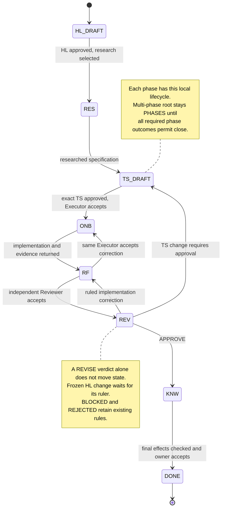
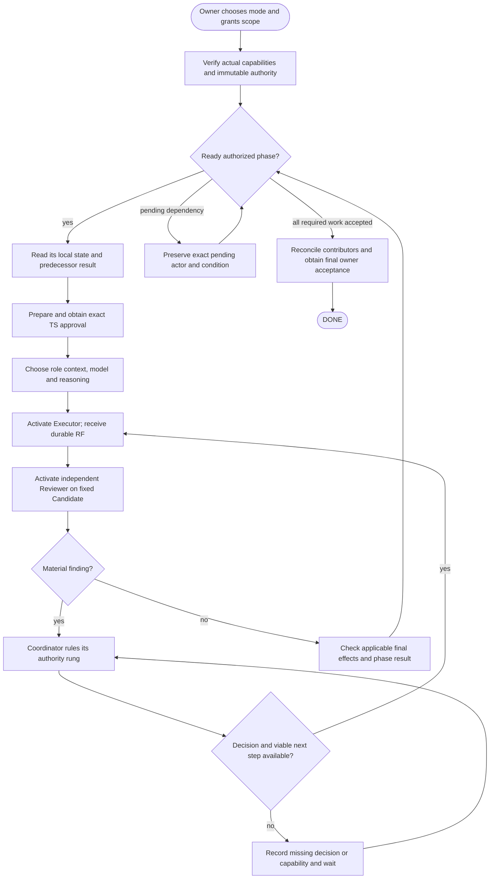
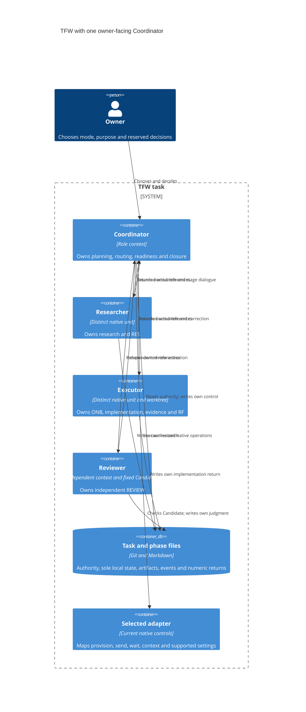

# TS — TFW_20261027-161333_CMODES: Три режима координации TFW

> **Date**: 2026-10-27
> **Author**: Codex, task Coordinator; accountable owner: saubakirov
> **Status**: TS_DRAFT — preparation during RES; execution is not approved
> **Parent HL**: [approved HL](HL-TFW_20261027-161333_CMODES.md), frozen at `28af8624b5a42f5078e6303ca844dabd1fbbcab6`
> **Producer**: `codex:thread:local:01a17d06-be29-7a31-afe4-bbd67c5cc3b7`, native `/root`
> **Selection**: owner-authorized subagents; delegated / baseline / native-gates / tfw-gates-only
> **Working branch**: `codex/cmodes`; integrated base `7e6daa42f3e544bab7b67f00cef80f25689793de`

## 1. Objective

Make manual, visible-agent and single-Coordinator subagent operation explicit, coherent modes of the same Full TFW workflow. Each admits one or several phases. The owner chooses the interaction arrangement; role ownership, phase authority, review, corrections and acceptance retain their meaning.

Value: the Coordinator can finish authorized work through native subagents without opening additional owner-facing role chats or impersonating other roles. The owner receives a traceable result, clear decisions, honest capability and resource coverage, and an explanation of changed behavior. Codex, Claude and other adapters share the semantics; actual mechanics and demonstrated reliability remain specific to the selected surface.

This is one delivery phase. The two-phase verification scenario tests the delivered capability; it is not a second product implementation phase.

## 2. Scope

### In Scope

- Three named modes, current mode selection and safe adoption/change, including one real task Coordinator owning several phase-local cycles.
- Current state reader/writer contract, complete historical compatibility, exact authority inspection and refusal of ambiguous/partial routing.
- Native subagent role activation, receiving-context checks, independent review, correction continuity, phase context policy, interruption and unavailable-capability handling.
- Coordinator choice of available model and reasoning effort, with a justified quality floor and progress-based adjustment within actual supported controls.
- Coherent canonical rules, selected profiles, persistent adapter templates, tracked installed copies, public guidance and applicable update path.
- Existing ECFIX accounting interface consumed through ordinary dispatch/return lineage; no second accounting system.
- Bounded evidence, required documentation/knowledge effects and owner-facing semantic comparison of the result.

### Out of Scope

No new scheduler, orchestration daemon, provider-independent agent runtime, agent roster, consent language, schema-version field or second state machine. No Ralph plugin or stop-hook installation. No economics collector/source-discovery rewrite, copied-history experiments, tariff work or automatic phase allocation. No automatic migration of existing tasks, history rewrite, provider switch, release, push or other-project update. Light, Assisted and optional Daily retain their scope. No additional permanent tests without the owner's separate agreement.

## 3. Principles Check

| # | HL §7 principle | Enforced by | Gate |
|---|---|---|---|
| P1 | One meaning, native mechanics | AC-1, AC-9 | Common semantics agree with each selected profile; capability claims name actual surface and level |
| P2 | One Coordinator is a supported topology | AC-2, AC-3 | Same actual Coordinator across dependent phases, local phase completion, no self-send |
| P3 | Independent judgment survives convenience | AC-4, AC-6 | Distinct role contexts and fixed-Candidate independent review |
| P4 | Progress within authority | AC-3–AC-7 | Ready work advances; missing decisions and no-progress causes take their actual route |
| P5 | Minimal complete structure | AC-2, AC-8–AC-10 | One mode field, existing records/owners, no duplicate accounting or runtime |
| P6 | Truthful compatibility | AC-2, AC-6, AC-9 | Historical meaning, actual receiving context and evidence limitations remain visible |

## 4. Affected Files and Value-Bearing Accounting

The literal VALUE selector below contains **38 paths**. Whole-path purpose determines classification, including shipped copies. This is a forecast, not a claim that these edits already exist. The Executor may avoid an unnecessary listed edit and explain it in RF; a necessary additional constituent requires a prospective ruling under the unchanged scope and budget rules.

| Files | Action / class | What changes, why and value |
|---|---|---|
| `.tfw/conventions.md`, `.tfw/glossary.md` | MODIFY / VALUE | Define the three modes, same-holder phases, current state, phase/round context and continuation semantics once; remove conflicting mandatory topology |
| `.tfw/workflows/plan.md`, `.tfw/workflows/research/base.md`, `.tfw/workflows/handoff.md`, `.tfw/workflows/review.md`, `.tfw/workflows/init.md`, `.tfw/workflows/update.md` | MODIFY / VALUE | Make creation, activation, execution, review and adoption consume the same contract without bypassing role gates |
| `.tfw/templates/HL.md`, `.tfw/templates/status.md`, `.tfw/templates/journal/event.md`, `.tfw/templates/RF.md` | MODIFY / VALUE | Ensure newly emitted selection, routes, events and return provenance are complete and interpretable |
| `.tfw/adapters/README.md`, `.tfw/adapters/codex/coordinator.md`, `.tfw/adapters/claude-code/coordinator.md`, `.tfw/adapters/antigravity/coordinator.md` | MODIFY / VALUE | Explain mode selection and actual native routes; remove visible-only/small-one-phase limitations; keep provider evidence honest |
| `.tfw/adapters/codex/AGENTS.md.template`, `.tfw/adapters/claude-code/CLAUDE.md.template`, `.tfw/adapters/cursor/tfw.mdc.template`, `.tfw/adapters/antigravity/tfw-rules.md.template` | MODIFY / VALUE | Installed entry instructions must admit the same workflow; Cursor remains a common-only adapter |
| `AGENTS.md`, `CLAUDE.md`, `.agents/rules/tfw.md` | MODIFY / VALUE | Synchronize managed persistent copies while preserving project-owned text |
| `.claude/commands/tfw-plan.md`, `.claude/commands/tfw-research.md`, `.claude/commands/tfw-handoff.md`, `.claude/commands/tfw-review.md`, `.claude/commands/tfw-init.md`, `.claude/commands/tfw-update.md` | MODIFY / VALUE | Synchronize the six tracked full-workflow copies exactly |
| `tools/tfw_state.py` | MODIFY / VALUE | Validate the new current form and contextual parent routes while retaining complete historical forms |
| `README.md`, `README.ru.md`, `README.kk.md`, `.tfw/CHANGELOG.md`, `docs/scripts/gen_docs.py` | MODIFY / VALUE | Align owner guidance in three languages, describe the change and expose the adoption guide in generated documentation |
| `.tfw/migrations/coordination-modes.md` | CREATE / VALUE | Give pinned updates a bounded adoption guide; distinguish unchanged continuation, format adoption and a new human choice |
| `KNOWLEDGE.md` | MODIFY / VALUE | After independent review, update only affected current architecture/reference relationships |
| `knowledge/records/TKL-20261027-CMODES.md` | CREATE / VALUE | After independent review, preserve the accepted scoped successor to prior topology/context decisions with sources and limitations |
| `docs/scripts/command_entry_eval.py` | MODIFY / ASSURANCE | Keep its synthetic new-status fixture consistent; this evaluation harness is not the accepted product |
| This task's HL/TS, research, ONB/RF/REVIEW, EV, journal, status and received numeric records | CREATE/MODIFY / TRACE | Preserve decisions, actual evidence and lifecycle; location never excludes an actual shipped output |
| Temporary scenario scripts, isolated fixtures and raw outputs under system temp `tfw/TFW_20261027-161333_CMODES/` | CREATE / ASSURANCE or working material | Bounded verification; remove owned scratch after durable findings/limits are recorded |
| Generated site outputs | DERIVED | Reproducible documentation projection; do not commit or independently accept it as a second source |

Thin Codex/Antigravity skill routers already delegate to canonical workflows and are expected to stay unchanged. No installed Cursor tree is currently tracked: verify its selected installation in an isolated receiver, without adding an unsolicited local installation. The manifest, project configuration, version, historical migrations/knowledge records, ECFIX's four accepted VALUE paths and unrelated work remain outside the planned edit set.

### Prospective accounting contract

| Fact | Proposed value for the existing TS approval gate |
|---|---|
| Subject | The complete coordination-mode delivery, including shipped copies and necessary reference/adoption documentation |
| Baseline | `7e6daa42f3e544bab7b67f00cef80f25689793de`; contains accepted ECFIX Candidate `1d1c7846bd9e97e3dcfa2d918300f424d5fc6976` |
| Selector source | Literal 38-path list in this TS at its eventual exact approval commit; no mutable branch name supplies authority |
| Candidate rule | First tested Executor commit containing required VALUE+ASSURANCE before EV/RF/REVIEW/final transition; TRACE-only writes do not move it. Later VALUE, including accepted documentation effects, requires a replacement Candidate, recomputation and independent judgment of the affected result |
| Logical VALUE files | 38 planned; one rename counts as one file |
| Touched text LOC | 1,500 additions + 900 deletions = 2,400 planned; forecast, not measured diff; actual numeric numstat fields decide, binary/non-text is per-file N/A |
| Soft decomposition prompts | 50 VALUE files or 5,000 touched LOC; cause/cost/assurance/split and a prospective terminal ruling are required when triggered |
| Multiplier / authority | 2 × immutable plan: owner decision before work at or above 76 files or 4,800 LOC, or a new planned-zero dimension. Below that, Coordinator may rule only a necessary constituent inside unchanged goal, outputs, AC, interfaces and authority |
| Approval epoch | No TS/denominator approval has been issued. Bind the owner's exact answer and full immutable approved TS commit before Executor dispatch; do not guess that SHA here |
| Failure dispositions | Missing, mutable, mismatched or late authority = BLOCKED; metric-only inapplicability = N/A; unresolved phase attribution = INVALID; DEFERRED is nonterminal |

The LOC estimate allocates 430 to core rules, 330 to workflows, 170 to templates, 520 to adapters, 520 to installed copies, 145 to the reader, 195 to public/adoption guidance and 90 to knowledge effects. These rounded estimates expose expected cost; they neither prescribe output length nor reward rewriting. Splitting the implementation into separately accepted fragments would leave current entry points contradictory. One coherent phase plus bounded checks is the proposed tradeoff.

```powershell
$valuePaths = @(
  '.tfw/conventions.md', '.tfw/glossary.md',
  '.tfw/workflows/plan.md', '.tfw/workflows/research/base.md',
  '.tfw/workflows/handoff.md', '.tfw/workflows/review.md',
  '.tfw/workflows/init.md', '.tfw/workflows/update.md',
  '.tfw/templates/HL.md', '.tfw/templates/status.md',
  '.tfw/templates/journal/event.md', '.tfw/templates/RF.md',
  '.tfw/adapters/README.md', '.tfw/adapters/codex/coordinator.md',
  '.tfw/adapters/claude-code/coordinator.md', '.tfw/adapters/antigravity/coordinator.md',
  '.tfw/adapters/codex/AGENTS.md.template', '.tfw/adapters/claude-code/CLAUDE.md.template',
  '.tfw/adapters/cursor/tfw.mdc.template', '.tfw/adapters/antigravity/tfw-rules.md.template',
  'AGENTS.md', 'CLAUDE.md', '.agents/rules/tfw.md',
  '.claude/commands/tfw-plan.md', '.claude/commands/tfw-research.md',
  '.claude/commands/tfw-handoff.md', '.claude/commands/tfw-review.md',
  '.claude/commands/tfw-init.md', '.claude/commands/tfw-update.md',
  'tools/tfw_state.py',
  'README.md', 'README.ru.md', 'README.kk.md', '.tfw/CHANGELOG.md',
  '.tfw/migrations/coordination-modes.md', 'docs/scripts/gen_docs.py',
  'KNOWLEDGE.md', 'knowledge/records/TKL-20261027-CMODES.md'
)
```

RF/EV/REVIEW replay `git diff --name-status --find-renames=50% -z` and `git diff --numstat --find-renames=50% -z` between the full Baseline and actual Candidate with exactly this selector plus any prospectively authorized necessary additions. Parse NUL-delimited output; do not subtract lines by hand or add ECFIX's already-baselined delta.

**Actions, not budget dimensions:** 36 planned VALUE modifications and 2 creations; 1 ASSURANCE modification; no planned VALUE deletion. **Proposed immutable denominator:** 38 VALUE files / 2,400 touched LOC; later rulings never ratchet it. No new numerical hard cap or M1–M6 constraint is proposed. Existing authority, role and confidentiality boundaries still apply.

### Preservation matrix

| Obligation | Required preservation / deliberate change | Result check |
|---|---|---|
| Authority and owner gates | Same HL/TS/amendment/overrun/final acceptance owners; selection is not blanket autonomy | AC-1–AC-3, AC-10 |
| Role Lock and ordered reads | Coordinator does not implement or author RES/ONB/RF/REVIEW; each role reads current task/phase control first | AC-4, AC-6, AC-9 |
| Four roles and workflow states | No new role or lifecycle; phase state remains local | AC-3–AC-5 |
| Messages | Existing closed catalogue and vertical routes; Research retains stage dialogue; owner discussion stays substantive | AC-1, AC-3, AC-4 |
| Review and REVISE | Fixed Candidate, complete material findings, exact ruler, no forced product redo for finite TRACE repair | AC-4, AC-5 |
| Model/effort judgment | Coordinator retains selection and justified adjustment under supported controls and owner policy | AC-7 |
| Economics | Accepted ECFIX semantics and numeric schema; contributors reconciled without duplicate totals | AC-8 |
| History and update | Complete old carriers/records remain truthful; current issuance and deliberate adoption are explicit | AC-2, AC-9 |
| Closing | Actual final-effect judgment, knowledge/documentation dispositions, resource coverage and owner acceptance | AC-10 |

## 5. Acceptance Criteria

### AC-1: Three understandable, independent operating choices

- [ ] Startup explains `manual`, `visible-agents`, `subagents`, who launches roles, where they live and what the owner will do. All three admit one or several phases; subagents admit one owner-facing Coordinator throughout.
- [ ] Mode, delegated authority, dialogue, reporting and phase topology remain separate choices. Manual provisioning does not silently select owner-transfer. Selecting visible-agent mode explicitly covers its role-chat launches; selecting subagents does not create user-owned chats.
- [ ] Missing native mechanics cause an exact pending action or owner-selected alternative, without substituting a different mode. Missing child-title controls are a navigation limit, not authority to invent a visible chat.

Gate: compare the canonical startup and selected adapter cards with task/phase selection examples.
Evidence: actual Codex selection/launch/return observations; other surfaces are labelled by their actual demonstrated level, not by analogy.

### AC-2: Explicit current state with truthful historical continuation [depends: AC-1]

- [ ] Current new task/phase issuance contains `coordination_mode: manual | visible-agents | subagents` plus the complete existing seven routing/selection fields. No implicit enum default.
- [ ] Complete historical five-field `owner_gateway` forms, with/without the selection pair, and complete pre-mode seven-field `upstream_route` forms remain readable and continuable under unchanged valid authority. Total absence is read-only; partial, mixed, downgraded-current and copied-old-as-new forms cannot activate new work.
- [ ] Deliberate format adoption can reuse a verified unchanged original human choice at a safe checkpoint. An actual mode/route/scope/reporting/dialogue change uses its proper selection/handoff/approval. Neither ordinary timestamp/lifecycle updates nor new TRACE commits invent a new authority epoch.
- [ ] Reader checks shape, enum, immutable object/path and contextual parent agreement. The receiving role also inspects the actual human source, scope, effect checkpoint, holder, parent, reservations and frozen ceiling; parser success is not consent.

Gate: temporary contextual matrix N1 covers new issuance, valid historical continuation/adoption and the named refusal cases through actual reader entry points. A helper with no caller is not evidence of production enforcement.
Evidence: actual receiving-role refusal/acceptance at the appropriate immutable source; the case record distinguishes structural validation from meaningful authority judgment.

### AC-3: One Coordinator, separate phase state and real dependency readiness [depends: AC-2]

- [ ] If task and phase have the same actual Coordinator C, phase `coordinator_route=C`; its real upward recipient is the governing human owner. Parent/owner/authority lineage and phase-local permission must agree.
- [ ] A distinct delegated phase Coordinator P retains phase `coordinator_route=P` and upward `coordinator:C`. Mode alone does not authorize either arrangement.
- [ ] Every phase owns its status, journal, scope and approved TS. A shared selection source may cover several phases but each adopts at its actual checkpoint; B requires A's applicable accepted dependency result independently of mode selection.
- [ ] Same-holder phase completion is a durable local result, without C-to-C send. Worker gates reach only their own `coordinator_route`; a distinct phase holder sends the existing bounded phase return. Root `PHASES` never becomes a second phase-state rollup.

Gate: N2 positive A→B route/dependency cases plus wrong parent, self-send, missing predecessor and worker-to-owner refusals.
Evidence: one bounded real two-phase validation task with the same actual C and distinguishable phase artifacts/returns, under this approved verification mandate. It does not alter this product task's frozen one-delivery-phase map. Record actual native identities and sources; a fabricated transcript or diagram is insufficient.

### AC-4: Independent review and a justified phase/round context policy [depends: AC-3]

- [ ] Researcher, Executor and Reviewer are distinct role holders; Reviewer does not inherit the Executor's private working context or participate as its design/implementation peer.
- [ ] A new phase starts with a fresh independent Reviewer context. Reusing the same Reviewer within that phase's authorized corrective rounds is normal while independence and scope remain valid; a fresh context every round is not required merely because a round number changed.
- [ ] An Executor's cross-phase reuse, if selected, needs a new bounded phase activation after a safe return, one active phase act, current authority/dependencies and actual receiving-context verification. Prior phase permission never carries over automatically. Reusing a Reviewer across phases requires an explicitly justified exception under the governing context policy, never silent reuse.
- [ ] Each review sees a full reachable immutable Candidate and its approved TS/RF/EV in an isolated/held view. Same ID does not prove correct cwd, base, phase, source bounds or independence. Replacement reconstructs durable context and reports actual identity; it does not pretend to be the old unit.

Gate: N3 fixed-Candidate review and ruled correction through the same E/R; N4 new-phase context policy, wrong scope/concurrent act and contaminated-review refusal.
Evidence: distinct actual Reviewer and Executor returns, at least one authentic ruled correction if a material finding occurs; if no material defect occurs, use a declared bounded validation case, never manufacture a defect in the accepted product to create a round.

### AC-5: Progress-aware continuation without a second lifecycle [depends: AC-4]

- [ ] Clarify that the three REVISE rungs address implementation, TS and frozen HL authority; they do not mean three retries. Current TFW has no general numeric execution↔review round cap. Research iteration/stage bounds remain separate.
- [ ] Each continued corrective round names the remaining material condition, changed approach/evidence expected and completion check in an existing owned record. Repeating an unchanged failing action without a new reason is not progress.
- [ ] On stagnation, the responsible Coordinator diagnoses context, tools, scope, model/effort or missing authority; it changes a justified supported control, narrows the next authorized act or returns the actual missing decision. Neither an arbitrary retry counter nor a completion token approves the task.
- [ ] Successful tool exit, child completion and passing checks do not mean independent approval or owner acceptance. Existing REVISE routing, safe interruption, cancellation and final-effect gates remain the only authority path.

Gate: false completion, repeated unchanged failure, contradictory authority, unavailable decision and stale durable-state cases; inspect actual progress/ruling record, not a second loop log.
Evidence: bounded continuation and negative cases at their stated level; Ralph findings must justify each adopted mechanism before this TS is presented for approval.

### AC-6: Continuation validates the real receiving context [depends: AC-2, AC-4]

- [ ] Before material resumed/replacement work, verify actual unit/parent, role/task/phase, workdir, reachable base/Candidate, immutable authority, open gates and return recipient. Retained native ID or application attachment alone is insufficient.
- [ ] Save attributable partial work and the exact pending act at interruption. Resume only with valid authority; respect user cancellation and preserve the previous effective route until an authorized successor acknowledges the durable context.
- [ ] Distinguish active concurrency, retained idle identities and proven disposal/release behavior. Phase count does not imply simultaneous agents. Serialize ready work within real capacity; a failed/unavailable mechanism remains factual, not a reason to merge roles or silently switch providers.

Gate: N5/N6 scenario selection names the actual supported operations and expected safe outcome; no unsupported controls are invented.
Evidence: demonstrate one available interruption/resume or authorized receiving-context replacement on the claimed Codex surface and record native capacity response if encountered. The Researcher's observed missing-checkout recovery is a bounded prior fact, not universal restart proof. Unavailable platforms/operations receive an exact disposition and narrow the claim; they never pass as executed.

### AC-7: Coordinator owns model and reasoning selection in every mode

- [ ] The actual launcher chooses among available models and separate reasoning controls to meet a justified quality floor, accounting for uncertainty, dependency breadth, risk, tools, expected rework, time and tokens.
- [ ] Existing owner policy persists; routine launches do not ask the owner to choose again. The rule neither mandates the cheapest/weakest model nor automatically selects maximum reasoning.
- [ ] Apply supported requested settings before launch and distinguish them from observed effective settings. Follow-up without a mutator cannot silently change the model; choose valid continuation or justified replacement through its normal gate.
- [ ] Failure-based adjustment targets the cause. A model change does not change Role Lock, authority, source identity or the need for independent review.

Gate: compare a suitable selected option with one plausible lower-resource alternative (or explain unavailable comparison), in ordinary dispatch; check same policy in agent/subagent/manual launch advice.
Evidence: current launch parameters and observed settings where exposed; no invented optimum, model efficacy or monetary saving.

### AC-8: Accepted ECFIX remains the only accounting contract

- [ ] Preserve ECFIX Candidate `1d1c7846bd9e97e3dcfa2d918300f424d5fc6976` as already integrated at Baseline, with its independent APPROVE, owner acceptance and bounded evidence limitations.
- [ ] Ordinary dispatch/return records identify actual invocation, task/phase, role, parent, native unit/source and exact receipt or typed failure/gap, including failed/retried/auxiliary invocations. Accounting membership never grants role authority.
- [ ] Include separate child sources when the parent excludes them; declare proven inclusive-parent membership and avoid adding both. A reused source needs proven bounds; no automatic per-phase split, zero-for-unknown or session-completeness claim.
- [ ] Coordinator reconciles expected contributors against returns/gaps after relevant role returns. Covering revisions replace their verified predecessors; native post-cutoff tails and unavailable setup/surfaces remain disclosed.

Gate: ordinary receipt validation/reconciliation on this task's actual role returns and a source-bound mapping to ECFIX; no duplicate source-discovery/collector experiments.
Evidence: producers supply their own exact numeric bytes or attributable gap. The Coordinator does not inspect peer raw sessions. Preserve ECFIX's guided-setup and finite-prefix proof limits.

### AC-9: Current consumers agree, with bounded provider claims [depends: AC-1–AC-8]

- [ ] Check the rule→workflow→template→profile→installed-copy→reader→public-guide chain. Remove surviving current visible-only or one-phase-only subagent restrictions and mandatory distinct phase Coordinator wording; retain historical evidence at its epoch.
- [ ] Canonical six workflows and their tracked Claude command copies are byte-identical. Managed persistent blocks match their templates; unselected/custom receiver content survives. Existing thin routers remain equal unless a necessary scoped change is ruled first.
- [ ] Pin a bounded old-receiver/update scenario and new-status scenario. Current issuance, unchanged valid continuation and deliberate adoption have distinct outcomes; no mass rewrite of active tasks.
- [ ] The generated documentation includes valid current links and the adoption guide. Codex/Claude/Antigravity/Cursor capability labels distinguish P0 documentation from actual operations and full P4 native trial; a Codex result does not prove another surface.

Gate: targeted contradictory-rule search with classification of every hit; existing generator/integration/blob tests; isolated receiver parity/adoption checks. Do not add permanent tests solely to satisfy this gate.
Evidence: actual installed Codex entry/role behavior in the bounded trial; selected Claude/other surface observations where available, otherwise explicit precise limitations and required next action. No universal native-admission claim without that provider's complete proof.

### AC-10: Explain and independently accept the complete result [depends: AC-1–AC-9]

- [ ] RF reports changed paths, meaningful before/after behavior, reasons, value, deviations and measured VALUE accounting against this unchanged denominator.
- [ ] The Coordinator presents the complete relevant revised Plan/mode/context passages and exact Candidate to the owner. Explicit passage acceptance and final acceptance remain distinct from independent REVIEW.
- [ ] Applicable technical/reference effects run through `/tfw-docs` after APPROVE; preserve ATC/PCUX/GSC/TEQM/ECFIX historical sources and add scoped relations. Human-sourced knowledge is qualified only by its actual route. No silent deferred close effect.
- [ ] Later changed accepted output gets the affected-result independent check and updated Candidate/accounting where VALUE changes. Required resource dispositions, economics coverage, status and journal agree before DONE.

Gate: independent REVIEW plus exact owner decisions and completed/N/A close effects with grounds; no push/release implied.
Evidence: actual final files/receipts/decisions, not a completion message or a marker alone.

### Evidence Artifacts

| File | Description |
|---|---|
| `evidence/EV__TFW_20261027-161333_CMODES.md` | Per-AC checks, exact subjects/Candidates, source limits and outcomes; reference compact durable facts rather than raw logs |
| Existing ONB/RF/REVIEW and review stage paths | Role-owned activation, implementation, independent judgment, actual correction bounds and context policy |

Relevant retained check command for approved implementation:

```powershell
python -m pytest docs/scripts/test_gen_docs.py docs/scripts/test_integration.py tools/tests/test_git_blob_sizes.py -q -p no:cacheprovider
```

Use system-temp destinations for disposable outputs where the existing tool supports them. Passing these checks protects the site/blob surfaces; it does not establish native coordination correctness.

## 6. Technical Guidance

Mechanics below explain the intended behavior. The Executor may choose a smaller coherent implementation and justify it in RF while meeting the ACs, exact schema/interface and authority constraints. No new workflow role or lifecycle is prescribed.

### Mode and route examples

| Arrangement | Phase worker recipient | Real upward recipient | Completion |
|---|---|---|---|
| One actual C owns task and phase | C | Human task owner | C writes the local phase result, then evaluates readiness; no message to itself |
| Distinct phase Coordinator P | P | Actual task Coordinator C | P returns the bounded phase result to C |

The same-holder arrangement requires verified governing permission, not merely `coordination_mode: subagents`. Manual and visible-agent choices retain their legitimate topologies; phase count alone is never an authority grant or a ban.

### State view — existing TFW lifecycle, selected relevant routes



This is a selected route view, not a replacement transition table. Optional no-research entry and all existing blocking/rejection/recovery edges retain their canonical owner.

### Activity view — what the Coordinator does



### Sequence view — same-phase correction and a new phase

```mermaid
sequenceDiagram
    actor H as Owner
    participant C as One Coordinator
    participant E as Executor A
    participant R as Reviewer A
    participant RB as Fresh Reviewer B
    participant F as Durable task and phase files
    H->>C: Mode and bounded authority; exact TS approval
    C->>F: Save dispatch, scope and launch choice
    C->>E: /tfw-handoff TASK/phase-a
    E->>F: Validate context; ONB, Candidate, EV and RF
    E-->>C: Durable return reference
    C->>R: /tfw-review TASK/phase-a
    R->>F: Independently inspect fixed Candidate; REVIEW
    R-->>C: Durable return reference
    opt Complete material correction is ruled
        C->>F: Record the executable bound or approved TS revision
        C->>E: Exact continuation reference
        E->>F: Correct bound; new Candidate when VALUE changes; RF
        E-->>C: Durable return reference
        C->>R: Exact review continuation reference
        R->>F: Independent judgment of corrected result
        R-->>C: Durable return reference
    end
    C->>F: Save accepted A result and check B readiness
    Note over C,F: Same C owns phase completion locally; no self-send
    C->>F: B authority, TS, executor dispatch and returned Candidate
    C->>RB: /tfw-review TASK/phase-b
    RB->>F: Fresh independent B review from durable inputs
    RB-->>C: Durable return reference
    C->>H: Checked result, changed passages, coverage and reserved decision
```

Messages are schematic references to the existing catalogue, not new signal names. The B Executor is omitted only to keep the view readable; B still requires its own valid execution and return.

### C4 container view — semantic ownership and native mechanism



These are responsibility containers, not new software services. In subagent mode native units are subagents; visible mode uses authorized visible role chats; manual mode leaves provisioning to the owner. The economics contract consumes the same attributable returns and adds no orchestration container.

## 7. Definition of Failure

- A current entry path still forbids legitimate subagents, limits them to one phase, or forces additional Coordinators solely because phases are multiple.
- Coordinator impersonates another role, Reviewer receives contaminated context, a fresh-phase claim merely renames the same context, or mutable output substitutes for a fixed Candidate.
- A mode field, parser result, inherited conversation, model setting, process exit or completion token supplies missing authority or acceptance.
- Historical tasks are silently migrated/reparented, new work emits incomplete old form, or phase state/loops acquire a second authority source.
- Repeated unchanged failure spends further resources without a justified next step; an arbitrary retry cap abandons authorized progress or waives required judgment.
- ECFIX work is overwritten/duplicated, contributors vanish, inclusive and child totals are added together, or unavailable measurements become zero.
- Required current consumers, owner passage acceptance, independent judgment or final effects remain unresolved while DONE is claimed.

## 8. Phase Risks

| Risk | Mitigation |
|---|---|
| Scope touches many copies and leaves contradictory wording | Exact consumer chain, canonical-first edits, managed equality and classified residual hits |
| New shape breaks old live tasks | W2 compatibility matrix; distinguish issuance/adoption from unchanged continuation |
| A retained native ID masks missing checkout or stale scope | Verify actual context before work; record observed recovery without a universal claim |
| Fresh context loses useful continuity or costs more | Fresh Reviewer per new phase; preserve valid same-phase corrective context; justify any exception |
| Native surface cannot execute the requested topology | Precise capability/result level, scoped fallback decision and no automatic substitution |
| Progress rules turn into a second scheduler or endless retries | Existing workflow/ruling records only; diagnose unchanged failure and preserve actual authority gates |
| Model change appears promised where no control exists | Separate choice, requested parameter and observed setting; supported replacement only |
| Post-review reference edits change accepted output | Updated Candidate/accounting and bounded affected-result judgment before close |

## 9. Cross-Phase Modifications

CMODES has one product delivery phase. Its disposable two-phase proof has separate local state and sources and does not duplicate ownership of product files. ECFIX is accepted and already in Baseline; its four VALUE paths need no CMODES edit. Preserve its closure and numeric limits. On a later change to shared semantics, inspect the actual affected accepted source and resolve the new dependency prospectively rather than merge by assumption.

### Planning sources and handover

Sources already accepted: iteration-1 [RES](research/iter1/RES.md) at `b1394ceda2202448bc84d95930ae68b0bcb4e199`; iteration-2 [RES](research/iter2/RES.md) at `a909a0bc6ae5a6b325bac4d2a9830d1216c0fe54`; frozen HL; ECFIX's accepted RF/REVIEW and four-path baseline parity. C2/W2/S1 is the selected specification basis; no consent parser, format epoch or registry is added.

Iteration 3 is currently completing H3/H4/H5 under the owner's explicit new direction. This draft is not yet offered for approval: final Ralph/context recommendations and source-bound limits must be inspected and incorporated first. No product implementation is authorized by the file's existence.

Saint-Exupéry check: one explicit mode field does a demonstrated inspectability job; existing task/phase state, dispatch, role artifacts, REVISE rulings and economics retain ownership. The adoption guide protects receivers, installed copies protect actual entry, and four views answer the owner's requested explanation without introducing a diagram registry. Required proof is bounded; no permanent test expansion or extra product phase is proposed.

---

*TS — TFW_20261027-161333_CMODES | 2026-10-27*
