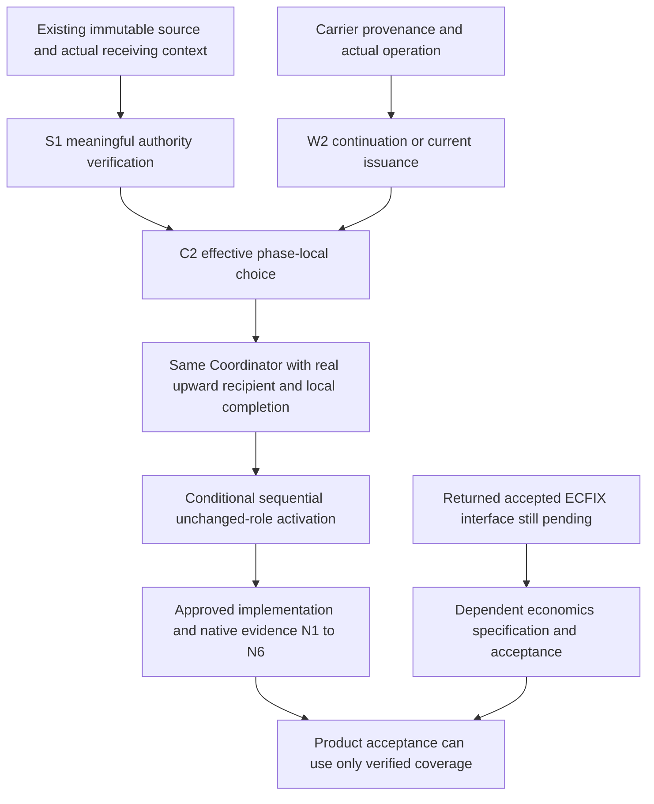

# RES — TFW_20261027-161333_CMODES: Coordination contract refinement

> Date: 2026-10-27
> Author: codex Researcher, on behalf of saubakirov
> Status: Research synthesis complete; specification recommendations, not product acceptance
> Parent HL: [approved task HL](../../HL-TFW_20261027-161333_CMODES.md)
> Mode: Pipeline / focused; iteration 2
> Producer unit: `/root/cmodes_research`, native source thread `01a17db6-0f53-7603-878a-adaa590010e4`
> Parent Coordinator: `codex:thread:local:01a17d06-be29-7a31-afe4-bbd67c5cc3b7`, native `/root`
> Activation / dispatch source: `journal/20261027-195312__dispatch__82a7.md @ 4fb66e15f98f8f760a615e22f92f3bc44262e27c`
> Coordination authority: `HL-TFW_20261027-161333_CMODES.md @ 28af8624b5a42f5078e6303ca844dabd1fbbcab6`
> Originating proposer: none; this same Researcher continued under the authorized Coordinator
> Effective selection: baseline / native-gates / tfw-gates-only; no governed phase token

## Research Context

Two focused passes investigated how manual, visible-agent and subagent operation can share a portable coordination contract while one actual Coordinator may govern dependent phases. [Iteration 1](../iter1/RES.md) at `b1394ceda2202448bc84d95930ae68b0bcb4e199` established alternatives, current rejecting consumers and evidence limits. Iteration 2 refined C2 into a specification-ready recommendation: explicit current mode, a precise historical/current write boundary, semantic authority inspection using existing immutable sources, and conditional sequential reuse of unchanged role units. It did not implement that contract or execute an independent E/R product cycle. ECFIX's accepted interface has not returned; that dependent question remains separate from the sufficiency of the independent H1/H2 research.

## Briefing

[Briefing](1_briefing.md) at `3faf1ef2245b1dce4ec9f477ce330146cb35a052` was accepted before Gather. [Gather](2_gather.md) at `6ff344568784f9bf8dfe04f4ed6add5a49149c27`, [Extract](3_extract.md) at `b7517e489bea72d8383bd09af50e3442a87b840e` and [Challenge](4_challenge.md) at `2c42b6f71b521f707130da14a180307fcaf84d4a` were separately accepted by `/root`. Detailed alternatives and adverse-case matrices remain in those traces; this RES records the surviving contract and its remaining obligations.

## Decisions

These are research recommendations for Coordinator classification and TS, not amendments, live selections or architecture verdicts.

| ID | Recommendation | Rationale |
|---|---|---|
| D1 | Use C2 with M=W2/S1 as the common specification basis; retain C1 as a viable fallback | Explicit mode improves inspectability; existing immutable provenance plus accountable agent judgment is sufficient without a consent grammar/runtime |
| D2 | Apply current C2 shape to new task/phase carriers and deliberate adoption; preserve unchanged complete historical carriers during ordinary valid continuation | Avoids inferred mode, coerced migration on routine returns and historical rewriting |
| D3 | Keep source-integrity/structural validation distinct from actual authority verification | Current parser success does not prove owner assent, scoped permission or effective checkpoint |
| D4 | For direct same-holder phases, use real owner upward, local completion and workers returning only to the exact local Coordinator | Preserves real destinations and phase-local state without self-send or worker-to-owner bypass |
| D5 | Permit conditional sequential new-phase activation of an existing unchanged E/R role, subject to the receiving contract below | Retains role independence and scope without assuming either fresh unit creation or automatic cross-phase permission |
| D6 | Preserve exact native capability/refusal boundaries and stop on unsupported next action | Completed or idle units do not prove slot release; absence of close-agent cannot be bypassed |
| D7 | End the two planned source-research passes; carry native implementation evidence into approved execution and ECFIX into its own dependency | More reading of the same sources would not supply the missing product/native proof or neighboring accepted result |

### Current issuance, historical continuation and authority

Proposed C2 adds `coordination_mode: manual | visible-agents | subagents` to the current seven routing/selection fields, retaining one current `upstream_route`. A new task or phase must issue the full current form even if initialized from an old file. Genuine historical five-field `owner_gateway`, that form with the selection pair, and pre-mode seven-field `upstream_route` carriers remain readable under their actual authority. Total absence remains legacy read-only; partial, mixed or downgraded current forms cannot activate dependent work. Mode absence supplies no enum default.

W2 distinguishes actual operations using the selected carrier's provenance and governing source. An unchanged-scope lifecycle/timestamp update or a new role artifact under valid existing authority is ordinary continuation, not a new mode decision. Deliberate format adoption may reuse a verified unchanged original choice at a safe checkpoint without inventing a human selection event. An actual change of mode, reporting/dialogue, holder/route or authority/activation scope requires its proper selection, handoff or approval; frozen changes retain the amendment route. Removing mode from an already current carrier is not historical continuation. New TRACE commits do not advance the frozen authority epoch.

S1 requires the receiving agent to inspect the exact immutable baseline/event and actual human source; compare the stated choice, previous/current values, phase/role scope, reservations and HL ceiling; establish actual checkpoint applicability and unit/parent/owner identities; then either perform only the supported act or return the precise gap. Mechanical checks remain useful for shape, enum, object/path, event envelope and contextual parent agreement. They do not certify consent. Meaningful agent verification and refusal on ambiguity are part of the complete contract, not a placeholder for future total machine verification. Grounds belong in existing owned records, with no replay-derived live state.

No demonstrated consumer justified a second schema epoch, new event fields or canonical consent grammar. W1's every-mutation migration adds an avoidable continuation gate; W3/S2/S3 add machinery without removing semantic judgment. C1 remains viable if the explicit mode field is declined, at the cost of resolving mode from the exact source wherever needed.

### Dependent phases and safe holder changes

A direct phase can use owner H upward only when its local C is the actual governing task Coordinator, owner/authority lineage agrees and effective phase permission covers the topology. A distinct delegated phase retains its local P and upward C. Mode alone never supplies this permission. A source covering A and B may be shared, but each phase adopts locally at its actual checkpoint. B's predecessor readiness and approved scope/TS are independent requirements. Completion under the same C is a local phase record, not a C-to-C message; every worker gate/return still goes to that phase's `coordinator_route`.

A holder change requires saved state/gates, exact successor dispatch and acknowledgement, authorized route switch and appropriate phase-local adoption. It cannot silently reparent active workers or phases. Until the applicable transition is established, preserve the previous effective route and pause dependent acts whose current parent consistency is unresolved. A revocation event without delivered notice is a pending action, not evidence of remote halt.

### Conditional sequential reuse of unchanged E/R

Recommend allowing the same native Executor or independent Reviewer to receive a **new bounded activation for ready phase B within the same task and actual Coordinator**, subject to all of these conditions:

- A has a saved durable return and explicit stable state, reviewed/dependency result, unfinished effects and pending gates; the reused unit has no active A mutation/review act. B's actual predecessor condition is satisfied. Remaining Coordinator-owned close effects do not justify falsely marking A terminal.
- Only one phase act is active per reused unit. E remains Executor and R remains a separate Reviewer. The B dispatch names that actual existing ID, unchanged role, parent, scope and its own phase authority/approved TS/role gate; A's permission or correction mandate does not grant B.
- Before material B work, the receiving unit validates B's exact status/path, selection, lifecycle, authority, dependency and phase-local route, and records producer/activation provenance in its B artifact. A vague “continue” or wrong-scope command refuses.
- R retains independent role context: it has not acted as B's Executor, design peer or consolidator, nor inherited the Executor's private working context. Its own earlier independent review and admitted durable inputs may remain. A stricter B requirement for a fresh unit/context overrides reuse; context cannot be relabelled or claimed erased.
- B's approved TS/RF/EV bind a full reachable Candidate. R checks the actual reviewed object, workdir/base and evidence, with relevant mutation held or isolated. A's approval never approves B. Native resumption must retain the correct parent route and respect owner cancellation.
- If an A correction arrives during B, first save a safe B return/suspension, then activate the precise A correction. Assess B dependency impact before resuming B through its gate. Changed VALUE requires review of the new Candidate; no concurrent ambiguous A/B act is allowed.

This contract can be carried by ordinary phase dispatches and role artifacts. It introduces neither automatic cross-phase permission nor a phase-to-unit runtime registry. Initial independent R context and later bounded same-role reuse are distinct claims. The policy needs Coordinator acceptance for TS and native evidence in approved execution; this research launches no E/R units. The same native contributor identity with distinct phase activations supplies ordinary lineage only; ECFIX owns accepted numeric phase/range treatment.

### Capability and evidence coverage

Observed here: this exact Researcher's repeated addressed returns/continuations, its isolated managed worktree, clean stage commits, actual workdir and reachable frozen authority. Source-derived: current reader rejection of the proposed field and same-holder phase, limits of source/envelope validation, documented platform behavior and adverse-case contract analyses. Not observed: an implemented C2 reader/writer, independent fixed-Candidate Review/correction, real two-phase E/R reuse, restart/interrupt/replacement or slot lifetime.

The current surface exposes four slots including root and no close-agent tool. Sequential reuse avoids requesting extra identities only after those units exist; it does not guarantee initial launch, wake, replacement capacity or slot release. If the next authorized action lacks a supported lifecycle/transport/independent unit, return the exact pending action and responsible decision. Do not invent close-agent, use another task type's archive as disposal, spin on refusals or silently switch mode.

Future approved execution needs bounded evidence for these six families, not another repetition of source research:

| ID | Required native / implementation evidence |
|---|---|
| N1 | Contextual current writer/reader behavior: new full issuance, genuine complete legacy continuation, explicit adoption, copied-old new carrier, partial/mixed/downgraded form, unavailable source and mismatched/stale mode/scope/effect. Separate structural validity from receiving-agent authority judgment. |
| N2 | Actual dependent A/B states under the same C, their separate effective adoption and real predecessor readiness, local phase completion, and refusal of self-send, foreign holder and worker-to-owner bypass. |
| N3 | Distinct independent R reviews a full fixed reachable Candidate against approved TS/RF/EV; a ruled correction returns to the same E/R, with a new reviewed Candidate if VALUE changes. |
| N4 | If reuse policy is selected, unchanged E/R IDs accept bounded B activations only after the receiving conditions above; wrong-scope/concurrent-act cases refuse and retained A correction responsibility remains explicit. |
| N5 | At every claimed surface/version, actual interruption/restart and authorized replacement preserve or truthfully replace identity, actual path/base, authority and return recipient; user cancellation is respected. |
| N6 | Actual retained-idle capacity/lifetime behavior and the supported response to unavailable capacity; no disposal/release inference from completion. |

These are acceptance obligations for future approved work, not additional permanent tests authorized here. Product claims must be scoped to the operations/surfaces actually verified.

## Open Questions

| ID | Question | Status | Answer / next owner |
|---|---|---|---|
| Q1 | Is C2/M and the conditional reuse policy accepted into the specification? | Research recommendation ready | Coordinator classifies and prepares TS; this RES does not approve architecture or activate the policy |
| Q2 | What native operations work on the selected surfaces under real role gates? | Future execution evidence N1–N6 | Approved Executor and independent Reviewer, coordinated through actual parent; no repeated source research needed |
| Q3 | Which exact ECFIX accepted result/interface consumes the ordinary orchestration lineage? | Pending external dependency | ECFIX must return it through Coordinator; its draft HL alone and absence of conflict do not establish acceptance |

## Hypotheses (from HL §10)

| ID | Hypothesis | Incoming HL status | RES status | Evidence |
|---|---|---|---|---|
| H1 | Native subagents preserve exact role identity, independent review and durable continuation on each claimed surface | Partial support | Partial; native whole-cycle/recovery coverage unproved | Actual same-Researcher continuation plus primary documentation; N3–N6 remain unexecuted |
| H2 | One Coordinator can govern phases through a small coherent task-local extension | Coherent design, not implemented | Specification-ready recommendation; not implemented | C2/M, precise issuance/adoption/route rules and conditional unchanged-role reuse survived source-based challenge; N1–N4 remain owed |
| H3 | Existing economics plus the adjacent returned change supports new-mode lineage without another registry/collector | Deferred dependency | Pending; no positive or negative interface verdict | Only ECFIX draft HL `61f23f77dd7d039c10f4bab3ecff4ead1c369d46` was returned; no accepted interface supplied |

## HL Update Recommendations

### Refinements — free sections, Coordinator applies

| ID | Section | What to update | Source |
|---|---|---|---|
| R1 | §2 and §7.2 | Distinguish existing reader/source checks from semantic authority validation and current writer enforcement; cite the exact inspected epoch and primary sources | Gather G1–G2; Extract E1–E2 |
| R2 | §8 | Carry partial/mixed/downgraded carriers, stale selection, holder transitions, cross-phase role contamination and no-close capacity as explicit risks with refusal outcomes | Challenge C1–C4 |
| R3 | §9 and §10 | Record C2/M=W2/S1 with C1 fallback; conditional sequential unchanged-role reuse is specification-ready, not a new live grant or product verdict | Extract E1–E4; Challenge C3–C5 |
| R4 | §10 | Close the two planned H1/H2 research passes; retain H1 partial, H2 not implemented and N1–N6 as approved-execution obligations. Keep H3's external dependency separate | This RES, Hypotheses and Iteration Status |
| R5 | §11 | Separate next specification decision, native evidence delivery and exact ECFIX interface acceptance; do not create a third repeated source study or parallel accounting path | Challenge C5; Open Questions Q1–Q3 |

### Amendment Proposals — frozen sections

**No amendment proposals.** The recommendations preserve the frozen three modes, role independence, phase-local scope, reserved decisions and accounting obligations. The proposed reuse policy stays within unchanged roles and distinct bounded activations; it is for Coordinator specification acceptance, not an expansion of the current Researcher's mandate. Any later concrete frozen-scope change still needs the normal amendment route.

## Fact Candidates

No new human-only fact candidates. Conversation review found task-specific Coordinator rulings and research steering, already preserved in the stage acceptance traces. Code observations, platform documentation and this agent's proposed contract are not human domain facts for promotion.

## Strategic Insights (Research)

No new human-sourced strategic insights. The inherited owner choice to conduct this task through subagents remains in its frozen authority; this iteration adds bounded design analysis rather than a new owner preference.

## Findings Map

## Iteration Status

- **Iteration:** 2 of 2 minimum / 2 maximum; both planned research passes complete with this return. Only the Coordinator updates `iterations.yaml`.
- **Hypotheses tested:** H1 partial; H2 specification-ready, not implemented.
- **Hypotheses deferred:** H3's accepted-interface mapping, pending ECFIX return through the Coordinator.
- **Gaps discovered:** N1–N6 native/implementation evidence and exact ECFIX interface; no further independent H1/H2 source-research gap requires another pass.
- **Superseded decisions:** iteration-1 C2 preference is refined by W2/S1 and the conditional same-role B activation contract; Extract's abstract receiving-context question is resolved into this recommendation. C1 remains viable; no historical source is rewritten.

### Open Threads (after planned research)

| ID | Thread | Why it matters | Authorized next step |
|---|---|---|---|
| T1 | Accept and specify the common contract | Recommendations do not enact product behavior | `/tfw-plan` classifies these findings and prepares the approved implementation scope |
| T2 | Deliver bounded native proof | Source documents and arithmetic cannot prove role-cycle reliability | Approved execution/review supplies N1–N6 or scopes unsupported operations honestly |
| T3 | Receive and map ECFIX's accepted interface | Dependent economics specification/acceptance cannot be fabricated | Coordinator obtains the exact durable return and checks ordinary lineage against that interface |

### Recommendation

- [x] **SUFFICIENT** for the independent H1/H2 research scope — proceed to `/tfw-plan` for classification and TS preparation.
- [ ] **MORE NEEDED** as repeated source research — not recommended.
- [ ] **BLOCKED** for the entire research result — no; only dependent economics specification/acceptance remains open pending ECFIX.

The two planned iterations are complete as research, not as implementation or task closure. H3 remains an explicit nonterminal dependency. The Coordinator decides how to separate ready specification work from the dependent economics decision; this RES does not authorize accepting the latter in advance.

## Own Numeric Accountability — verified covering successor

Exact returned file: [revision 2 JSONL](../../economics/roles/52482daccf6bfd0fd416c7f1be215bec0ec27e25c020a7536d93be25a4c02dc0.jsonl), SHA-256 `52482daccf6bfd0fd416c7f1be215bec0ec27e25c020a7536d93be25a4c02dc0`. This is this Researcher's cumulative contribution across both iterations, not iteration-2-only consumption or a task/parent total.

| Receipt binding | Exact value |
|---|---|
| Revision / predecessor | `2` / `b0d26d09f16d23ee3f60fef9ff8be94dbbf9e3dd4845d8a1ebbd1e72f68c0d84` |
| Provider / native source | `codex.rollout` / `01a17db6-0f53-7603-878a-adaa590010e4` |
| Source version / helper | `0.164.0-alpha.11.1` / `tfw-economics/1.3` |
| Unit | `codex:thread:local:01a17db6-0f53-7603-878a-adaa590010e4`, the numeric contract spelling of native `/root/cmodes_research` |
| Task / phase / role / owner | `TFW_20261027-161333_CMODES` / null, no governed phase / `researcher` / `saubakirov` |
| Selected source range | `[0,757)` lines, complete selected prefix; source size `3860881` bytes |
| Source prefix SHA-256 | `f9eab745f8ff1b6118bc057b4731993740804e850be6acc7615b450871e9bb58` |
| Cutoff / captured at | `2026-10-27T15:25:50.344035+00:00` = `2026-10-27T20:25:50.344035+05:00` |
| Prior source prefix verified | `[0,400)`, SHA-256 `62d1218565fe0c5ee111d1380c5726a9c791736e0dfa96a04e9f49c92b0c3447` |
| Observed model / effort | `gpt-6-astra` / `high` |

The collector read only this bound child source at `${CODEX_HOME}/sessions/2026/10/27/rollout-2026-10-27T19-14-06-01a17db6-0f53-7603-878a-adaa590010e4.jsonl`. It verified the unchanged predecessor prefix, validated the numeric v1 JSONL and returned two aggregate usage rows. `receive` copied the exact bytes into this task's own `economics/roles`. The unchanged helper's `reconcile` was then invoked on exactly these two own receipt paths: it selected revision 2, excluded preserved revision 1 from totals, and returned no missing unit, omission, failure or reconciliation diagnostic. No parent/peer native source or receipt was an input.

| Cumulative measured metric | Value |
|---|---:|
| Fresh input tokens | 326,335 |
| Cached input tokens | 11,929,472 |
| Cache-write tokens | 0 |
| Input tokens | 12,255,807 |
| Output tokens | 66,877 |
| Total tokens | 12,322,684 |
| Reasoning tokens, included within output | 7,772 |
| Native completed-turn duration, 10 matched turns | 3,048.982 seconds |
| Collector operation duration | 0.03255 seconds |

Source diagnostics remain visible: 100 unique response records reconcile to native thread total `12,322,684`; the separate `token_count` total is `11,922,716` and disagrees. The collector selected the reconciled response stream and never added the streams. One `task_started` is unmatched at cutoff; its completed-turn duration is unknown. Native completed-turn duration, collector operation time and elapsed calendar time are different quantities; no subscription charge or price estimate is claimed.

`complete: true` means the entire captured prefix only. Final post-cutoff receipt validation/annotation, sealing commit, delivery and safe cleanup form a finite unmeasured tail; this does not recursively require another snapshot. Substantive reopened work must produce a new bounded continuation and cannot be hidden in that tail. Revision 1 remains byte-for-byte preserved and must not be summed with revision 2. Own measurement success does not establish H3's neighboring interface or whole-task coverage.

## Landing Scope

Iteration-2 own commits before this synthesis are `3faf1ef2245b1dce4ec9f477ce330146cb35a052`, `6ff344568784f9bf8dfe04f4ed6add5a49149c27`, `b7517e489bea72d8383bd09af50e3442a87b840e` and `2c42b6f71b521f707130da14a180307fcaf84d4a`, based on the Coordinator's `4fb66e15f98f8f760a615e22f92f3bc44262e27c`. The final synthesis commit is identified in the immutable parent return, avoiding a self-referential commit hash here.

Own landing paths are exactly `research/iter2/1_briefing.md`, `2_gather.md`, `3_extract.md`, `4_challenge.md`, `RES.md`, and `economics/roles/52482daccf6bfd0fd416c7f1be215bec0ec27e25c020a7536d93be25a4c02dc0.jsonl` under this task. The synthesis commit changes only Challenge acceptance, RES and revision-2 receipt. No HL, `iterations.yaml`, `status.md`, product file, peer artifact or predecessor receipt is changed. The isolated worktree remains `${CODEX_HOME}/worktrees/cmodes-research/steps-framework`; final Git status and the exact synthesis commit accompany the return. Do not replay iteration-1 commits as new contributions; they were already landed with original history.

## Conclusion

C2 with W2/S1 is the smallest coherent surviving recommendation: it makes mode inspectable while leaving permission in exact human-sourced authority, preserves historical continuation and separates bounded phase scope from native unit identity. Conditional sequential E/R reuse is usable for specification only when the receiving phase checks its own authority and preserves Reviewer independence. Research exposed the mistaken equivalences between parser success and consent, same ID and valid receiving scope, documented resume and actual native reliability, and completion and slot release. These conclusions are sufficient for independent H1/H2 planning, but remain source-based design analysis with limited own native observation; implementation evidence and ECFIX acceptance remain owed through their proper owners.

### Material handover at this return

Producer is the same Researcher named above. Inspected scope comprises the governing CMODES authority and controls, current state/selection reader and common contracts at `4fb66e15f98f8f760a615e22f92f3bc44262e27c`, accepted iteration-1/iteration-2 traces, own Git/native continuation observations and primary documents retrieved 2026-10-27. Material recommendations, uncertainties, open owners and evidence coverage are stated here. No peer/parent transcript, product implementation or economics experiment supplied the conclusion. Continue only through the exact parent Coordinator; retain this worktree for safe landing and any authorized continuation.

Primary references: [Codex subagents](https://learn.chatgpt.com/docs/agent-configuration/subagents), [Claude subagents](https://code.claude.com/docs/en/sub-agents#resume-subagents), [Claude worktrees](https://code.claude.com/docs/en/worktrees), [Git rev-parse](https://git-scm.com/docs/git-rev-parse), [Git revision/path addressing](https://git-scm.com/docs/gitrevisions). Stage findings identify the supported claims and limitations. Documentation is neither TFW authority nor evidence that the described native operations ran here.

---

*RES — TFW_20261027-161333_CMODES | 2026-10-27*
