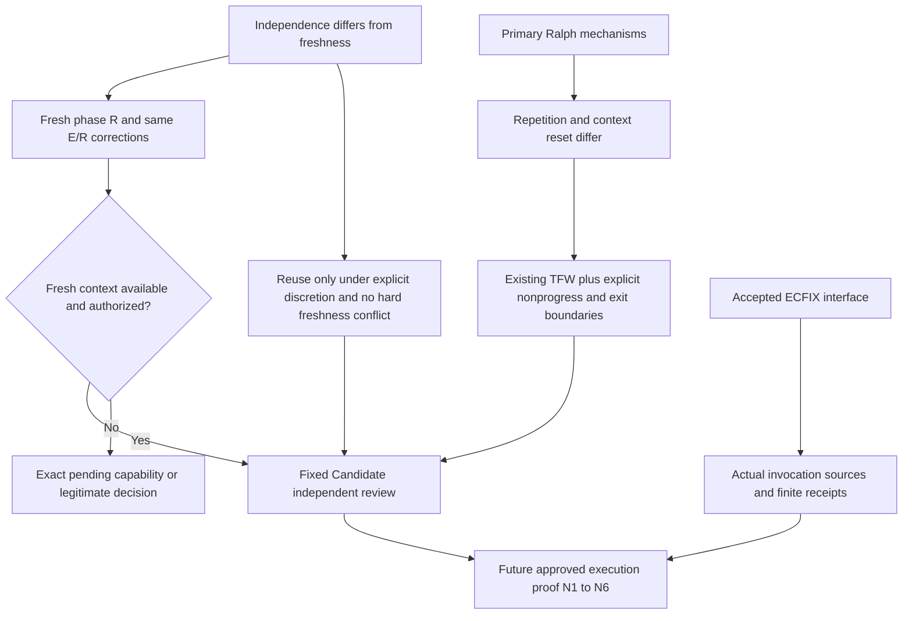

# RES — TFW_20261027-161333_CMODES: Bounded progress and phase review context

> **Date:** 2026-10-27
> **Author:** Codex Researcher; accountable owner saubakirov
> **Status:** Research iteration 3 complete; recommendation for specification, not product acceptance
> **Parent HL:** [HL-TFW_20261027-161333_CMODES](../../HL-TFW_20261027-161333_CMODES.md)
> **Mode:** Pipeline / focused
> **Producer unit:** `/root/cmodes_research`; `codex:thread:local:01a17db6-0f53-7603-878a-adaa590010e4`
> **Parent Coordinator:** `/root`; `codex:thread:local:01a17d06-be29-7a31-afe4-bbd67c5cc3b7`
> **Activation / dispatch:** `journal/20261027-231212__dispatch__5fb7.md @ 1d8706402f05ce725e8cbea472234fe2060cc7f7`
> **Coordination authority:** `HL-TFW_20261027-161333_CMODES.md @ 28af8624b5a42f5078e6303ca844dabd1fbbcab6`
> **Originating proposer:** none; owner-directed continuation through the same Coordinator
> **Selection:** baseline; delegated; native-gates; tfw-gates-only; no governed phase token

## Research Context

Iterations 1/2 established C2/W2/S1: explicit current mode, precise new-issuance/adoption versus valid historical continuation, and meaningful receiving-agent inspection of immutable authority. This owner-requested third iteration adds Ralph provenance and mechanisms, reopens the default review-context policy and maps the now accepted ECFIX interface. It recommends **M11: existing TFW with explicit nonprogress/exit boundaries, fresh independent Reviewer for a new phase and the same E/R for that phase's corrections**. M13, retained Reviewer across phases, is only a narrow exception under explicit granted discretion. No external loop, plugin, registry or new routine approval form is justified. H3/H4/H5 are sufficiently researched for TS; implementation and native proof remain separate.

## Briefing

The four owned stages are [Briefing](1_briefing.md) at `d6409914b0023ea96e00790ef711d949367d4013`, [Gather](2_gather.md) at `c96e496fe457bd36a4383a1fe106d00242dd6e8d`, [Extract](3_extract.md) at `6ee2ae6d5fd61f0c668be607635c161587c2d572`, and [Challenge](4_challenge.md) at `eaddf8e921d2d0a3aa63528f1d67073ef234d85f`. Each was returned to and accepted by the Coordinator before the next stage. Challenge acceptance authorized this synthesis. Previous RES remain immutable at `b1394ceda2202448bc84d95930ae68b0bcb4e199` and `a909a0bc6ae5a6b325bac4d2a9830d1216c0fe54`; this iteration refines the later cross-phase reuse recommendation without rewriting history.

The former own checkout was observed absent. With explicit Coordinator authorization, managed operation `b640d3c3-25a6-40ad-8b06-64d462d0f3b3` created and registered `${CODEX_HOME}/worktrees/cmodes-research-6923/steps-framework` at exact dispatch base `1d8706402f05ce725e8cbea472234fe2060cc7f7`. Identity, role and authority remained the same. This is one observed replacement-checkout receiving-context repair, not evidence of a host restart, the cause of disappearance or universal recovery. All iteration-3 mutations use that own checkout.

## Primary chronology and mechanism findings

Retrieval date is 2026-10-27. Publication, commit and current-content dates are deliberately distinct.

| Date established here | Primary source and bounded finding |
|---|---|
| 2025-07-14 | Geoffrey Huntley's [Ralph article](https://ghuntley.com/ralph/) displays this publication date and identifies the external-loop technique. It does not establish the invention day or date every paragraph of the present edited page. No July canonical standalone repository was established |
| 2025-11-16 | Official Claude Code [initial Ralph plugin commit](https://github.com/anthropics/claude-code/commit/68f90e05dd919b626c43351624fd0dc10c70b341), authored by Daisy S. Hollman, establishes this repository adaptation; commit date is not an inferred release date |
| 2026-01-06 | Official marketplace [rename commit](https://github.com/anthropics/claude-plugins-official/commit/44328beed48874d8e00da6c4ca5daaa5f0f3183c) changes the name to `ralph-loop` |
| 2026-01-07 | Ryan Carson's [initial `snarktank/ralph` commit](https://github.com/snarktank/ralph/commit/842e766fee9f73169d6f0988904177b095ad1286) establishes a separate PRD-driven fresh-invocation implementation |
| 2026-01-09 / 01-10 | Clayton Farr's [playbook first commit](https://github.com/ClaytonFarr/ralph-playbook/commit/347ecc8dfdc2fefa0c18102238a126542d1d3574) precedes [Huntley's fork](https://api.github.com/repos/ghuntley/how-to-ralph-wiggum). A creator-hosted fork is not the original July codebase |
| 2026-03-02 / 03-28 | Official plugin [session guard](https://github.com/anthropics/claude-plugins-official/commit/8644df9ad51fe1dadc5d067e806c3c686efeafff) and inspected [later revision](https://github.com/anthropics/claude-plugins-official/commit/986deab6a1659ebb998b66962df6f02b20bb884d) mean old missing-isolation reports cannot describe all current behavior |

The later [playbook snapshot](https://github.com/ghuntley/how-to-ralph-wiggum/blob/88d488a148af97e4a3f22b11b4c3598c79d6a577/README.md) explains outer fresh-context invocations with persistent specs/plan and feedback. The official [Stop hook](https://github.com/anthropics/claude-plugins-official/blob/986deab6a1659ebb998b66962df6f02b20bb884d/plugins/ralph-loop/hooks/stop-hook.sh) instead repeats a prompt in the same session and can allow exit on a cap, malformed/missing input or assistant promise. Carson's [script snapshot](https://github.com/snarktank/ralph/blob/6c53cb0b831ebe8739c6a003e22af14902d8b0b5/ralph.sh) starts fresh processes, retains PRD/progress and accepts a completion token. These mechanisms have different context and failure boundaries. Neither process exit nor assistant text independently proves accepted product completion. No source script, hook, plugin or external agent loop was executed; no quality/ROI benchmark was established.

## Decisions

These are research recommendations for the Coordinator's TS and its existing approval route, not live policy changes issued by the Researcher.

| # | Decision | Rationale |
|---|---|---|
| D1 | Preserve C2/W2/S1 and select M11 as the minimal specification policy | Existing artifact/authority consumers suffice; no demonstrated need for a runtime, schema epoch, per-round form or duplicate task list |
| D2 | Make recurring unchanged failure and non-success exit explicit at the existing return/ruling | A bounded diagnostic or changed basis can justify another authorized act; blind redispatch, cap exhaustion and completion text cannot supply acceptance |
| D3 | Fresh independent R by default at a new governed phase; same E/R for ordinary corrections within that phase | Separates new-phase context from ruled correction history. TS revision or corrective round alone does not create a new phase |
| D4 | M13 only under explicit exception discretion and full receiving checks | The actual phase-responsible Coordinator may exercise a granted choice; Reviewer/Executor cannot grant it. Hard freshness and independence override convenience |
| D5 | Decide E continuity separately | Fresh B Reviewer does not force fresh E. Sequential unchanged-E B activation still needs separate B authority, scope, actual path/base and source/return binding |
| D6 | Keep an unavailable fresh-R requirement nonterminal with a named capability/decision | Safe refusal is coherent; guaranteed completion on every host is not. No exposed close-agent or observed slot-release behavior may be invented |
| D7 | Consume accepted ECFIX without VALUE edits | Existing invocation membership, source bounds and covering-successor semantics cover the policy; no interface defect was established |
| D8 | Do not adopt L2/L3 orchestration or universal fresh-R-per-round R2 | Additional invocation/hook machinery and repeated context reconstruction have no demonstrated current benefit. A later concrete workload may justify a separately authorized proposal |

### Receiving policy and stopping boundary

The actual Coordinator governing B may choose a reuse exception only when accepted policy expressly grants that discretion and no scoped HL/TS/owner requirement forbids it. A delegated phase Coordinator must possess that discretion in its actual mandate; parenthood or title does not supply it. The existing planning/dispatch record carries the concrete benefit and bound. No new consent grammar or template is required.

Reuse retains an unchanged role and actual identity; it requires B authority/approved TS and exact phase-local return route, explicit A completion/suspension and treatment of remaining A corrections, no conflicting simultaneous act, actual B path/base, independence and a fixed reachable Candidate with mutation stopped, plus real source/range binding. An A correction arriving during B requires serialized revalidation or a valid replacement. A fresh label, fork of Executor history, cleared title or unavailable capacity is not fresh independent review. Hard freshness can change only through its actual existing authority route. Normal same-phase corrections need neither a fresh Reviewer nor another owner selection gate.

If fresh R is mandatory but the available native mechanism cannot create that context, the pending condition is **an available authorized mechanism to provision and address a genuinely fresh independent B Reviewer, evidenced by an actual receipt, B authority/source binding and fixed reachable Candidate**. The phase-responsible Coordinator preserves the Candidate and nonterminal review, identifies that capability or the precise arrangement/policy decision for its legitimate resolver, and resumes when the approved condition is evidenced. It does not promise slot release or repeatedly ask for ordinary dispatch approval. An already authorized supported alternative may be used; a hidden helper or unauthorized provider switch may not.

REVISE's three rungs are authority levels, not three attempts. Ordinary bounded tool retries stay inside execution authority. Material repeated failure returns through existing RF/REVIEW/ruling with a changed basis or a missing condition; no complete material finding means no manufactured correction round. Cancellation and absent authority stop the affected act. Coordinator model/effort choice continues to use the quality floor, plausible lower-resource alternative and supported controls; neither weakest-model-first nor automatic maximum follows from failure count.

### Minimal implementation consumers

The incremental H4/H5 change belongs in `.tfw/conventions.md` continuity/REVISE, `.tfw/workflows/plan.md` dispatch/return, `.tfw/workflows/review.md` receiving identity/independence, `.tfw/workflows/handoff.md` E continuation/return, and the unqualified same-holder sentence in `.tfw/adapters/codex/AGENTS.md.template` plus its installed root copy. Generic TS/RF/REVIEW scope, evidence and handover sections already carry the facts; H4/H5 alone justifies no new template field. C2/W2/S1's prior full consumer and installed-copy integrity obligations still apply. The Coordinator defines exact selectors and denominator in TS rather than treating this incremental map as the entire delivery set.

State views separate lifecycle/gates from attempts; activity views show diagnosis/continuation/stop; sequence views show fixed Candidate, same-phase E/R correction and distinct fresh-R or authorized-exception branches; C4 shows human/native host/role/workspace boundaries. Show the unavailable-capability branch explicitly, not an unconditional successful cycle or a new controller service.

### Accepted economics interface

ECFIX Candidate `1d1c7846bd9e97e3dcfa2d918300f424d5fc6976`, integration `7e6daa42f3e544bab7b67f00cef80f25689793de` and owner closure `17fadc71` bind the returned [RF](../../../TFW_20261027-160926_ECFIX/RF__TFW_20261027-160926_ECFIX.md) and [REVIEW](../../../TFW_20261027-160926_ECFIX/REVIEW__TFW_20261027-160926_ECFIX.md). Its four accepted VALUE files remain unchanged. Ordinary dispatch/launch/return identifies expected invocations, including failed/retried/auxiliary work; membership grants no role authority. Each real source binds actual unit/task/phase/range. Verified covering successors replace totals while preserving predecessor bytes; new sources bind separately; parent inclusion/copying needs observed semantics. Missing binding or failed extraction remains attributable nonmeasurement with last-good coverage, never zero or success. Accepted setup/version/surface limits and substantial self-return tails remain disclosed; receipt of every file does not establish current whole-cycle coverage. No parent/peer source or repeated provider experiment was used here.

## Open Questions

| # | Question | Status | Answer / next owner |
|---|---|---|---|
| Q1 | What policy and delivery selectors become binding? | Ready for TS | Coordinator applies recommendations through existing specification/approval; no additional research pass is needed |
| Q2 | Which actual surfaces execute the full governed cycle and recovery? | Future execution proof | Approved Executor and independent Reviewer supply N1–N6 or honestly narrow the claim |
| Q3 | What if hard fresh-R provisioning is unavailable? | Exact conditional dependency | Existing Coordinator owns capability resolution or returns the specific change decision to its actual ruler; no generic new owner gate |
| Q4 | Is the economics interface still an external research blocker? | Resolved input | Accepted ECFIX supports the mapping; future invocation receipts must still establish their own actual coverage |

## Hypotheses (from HL §10)

| # | Hypothesis | HL status at input | RES status | Evidence |
|---|---|---|---|---|
| H1 | Native subagents preserve identity, independent review and durable continuation on claimed surfaces | Partial | Partial, not full-cycle verified | Own bounded Researcher continuation/checkout repair; N1–N6 remain |
| H2 | One Coordinator can govern phases through a small coherent extension | Specification-ready | Specification-ready, unimplemented | Accepted C2/W2/S1 plus this bounded context policy; no product mutation |
| H3 | Existing economics and accepted adjacent interface account for new-mode lineage | Accepted interface available | Sufficient mapping for TS | Returned ECFIX and common contract; no competing collector or registry |
| H4 | Useful Ralph transfer can improve continuation within TFW authority | Open for iteration 3 | Sufficiently researched: minimal policy transfer, no loop installation | Primary chronology/mechanisms; concrete exit/nonprogress consumer benefit; no measured performance claim |
| H5 | Fresh R per phase with same-phase correction continuity is the best default here | Open for iteration 3 | Supported specification recommendation with explicit exception/liveness bounds | Grouped source-based challenge; independence, freshness and reset cost separated; no measured superiority |

### Required future execution evidence

| Family | Still unpassed obligation |
|---|---|
| N1 | Actual current writer/reader behavior for new issuance, complete legacy continuation, deliberate adoption, copied-old new carrier, partial/mixed/stale/mismatched sources; structural validity separate from semantic authority |
| N2 | Actual dependent A/B states under one C, separate adoption/readiness, local phase completion, refusal of self-send/foreign-holder/worker-to-owner bypass |
| N3 | Actual fresh independent phase R reviews a fixed reachable Candidate against approved TS/RF/EV; ruled corrections return to the same E/R and changed VALUE yields a newly reviewed Candidate |
| N4 | When reuse is selected, actual unchanged role identity accepts bounded B activation under all receiving conditions; wrong-scope/concurrent acts refuse; R reuse additionally needs explicit discretion and no hard freshness conflict |
| N5 | Actual interruption/restart/replacement at each claimed surface/version preserves or truthfully replaces identity, authority, path/base and recipient; cancellation respected |
| N6 | Actual retained-idle capacity/lifetime behavior and supported unavailable-capability response; completion/archive is not assumed release |

These are approved-execution obligations, not authorization to add permanent tests or repeat source research. Scenario reasoning and documentation have not passed them.

## HL Update Recommendations

### Refinements — free sections, Coordinator applies

| # | § | What to update | Source |
|---|---|---|---|
| R1 | §2 | Record accepted iteration-3 conclusions and the limited checkout-repair observation without claiming restart proof | Briefing recovery; this RES |
| R2 | §7.2 | Add primary Ralph chronology and pinned mechanism sources; preserve current-versus-historical evidence | Gather G1/G2; chronology above |
| R3 | §8–§9 | Add fresh-context capability risk, bounded default/exception and minimal current-consumer implications; preserve no-runtime and no-slot-release constraints | Extract E3–E5; Challenge C2–C4 |
| R4 | §10 | H3 accepted mapping; H4/H5 sufficient for TS; H1 partial/H2 unimplemented with N1–N6 explicit | Hypotheses and future evidence above |
| R5 | §11 | Close further research need; proceed to specification/approval and bounded implementation proof | Accepted stage sequence and sufficiency |

### Amendment Proposals — frozen sections, resolved-ruler verdict required

**No amendment proposals.** M11 refines the approved independent-review, authority, minimal-structure and truthful-capability goals. The frozen DoD already requires a concrete pending condition where capability is missing. It does not require an external loop, unconditional completion on every host or a universal right to reuse R. A future decision that actually changes a scoped hard constraint must use its existing ruler; this RES grants none.

## Fact Candidates

No new human-only fact candidates. Owner directions on the third iteration, context concern and Coordinator model selection are already retained in the dispatch/HL. Technical source observations are research evidence, not new human-domain facts for promotion.

## Strategic Insights (Research)

The owner's renewed concern about fresh review at phase boundaries, retained in the iteration-3 dispatch and Briefing, makes phase freshness an explicit design choice instead of a side effect of capacity or earlier reuse permission. Its implication is M11 with bounded exception authority, while same-phase correction continuity remains intact. This is a task-specific research inference from recorded direction, not independently verified general domain knowledge.

## Findings Map

## Iteration Status

- **Iteration:** 3 of 2 minimum / 3 maximum; owner-requested new scope after the two accepted passes.
- **Hypotheses tested:** H3 accepted interface mapping; H4 minimal transfer; H5 default/exception context policy.
- **Hypotheses deferred:** none requiring more research; H1/H2 implementation/native proof remains outside Research.
- **Gaps discovered:** conditional fresh-R provisioning limit and still-unpassed N1–N6; no additional source pass resolves them.
- **Superseded decisions:** iteration-2 symmetric conditional E/R cross-phase reuse is refined: R is fresh by default with a narrowly authorized exception; E continuity remains independently selectable under receiving conditions. C2/W2/S1 and historical records remain.

### Open Threads

No further research iteration is recommended. Coordinator specification/approval and subsequent execution/review own Q1–Q3 and N1–N6. Accepted economics input resolves the former dependency; actual new receipts still carry their own coverage obligations.

### Recommendation

- [x] **SUFFICIENT** — proceed to `/tfw-plan` to classify recommendations and complete TS.
- [ ] **MORE NEEDED** — no additional research pass justified.
- [ ] **BLOCKED** — Research is not blocked; the described unavailable fresh-R case is a conditional execution dependency.

## Conclusion

The research separates Ralph's attributable origin and later implementations from unsupported universal loop claims, then extracts only a small useful TFW policy: explicit progress/termination judgment and a phase-sensitive review context boundary. M11 and its strictly authorized M13 exception preserve authority, independent fixed-Candidate judgment and ordinary correction continuity without another runtime. Accepted ECFIX provides the accounting interface. The result is ready for specification, with a real capability dead end stated honestly and all native proof still bounded by N1–N6; it is not a tested implementation or measured cost/quality advantage.

### Material handover and resource disposition

Same producer/parent and exact source epochs above. Material findings are the minimal policy, exception ruler, fresh-context pending condition, primary chronology and accepted-interface mapping; full stage evidence remains in its original files. No HL/TS/status/control, product code, economics VALUE or other role artifact was changed. The own managed checkout is retained for Coordinator landing and necessary bounded continuation; it is not archived or assumed to release a slot. The Coordinator-owned candidate remains untouched. Research temp material is removed after receipt verification; own receipt bytes remain durable under the task. Any later substantive work requires a new source bound rather than extension of the finite delivery tail.

### Own numeric accountability

The substantive synthesis and its final content checks preceded the capture. Only source `codex.rollout:01a17db6-0f53-7603-878a-adaa590010e4` was selected; no parent or peer source was collected. Exact source path: `${CODEX_HOME}/sessions/2026/10/27/rollout-2026-10-27T19-14-06-01a17db6-0f53-7603-878a-adaa590010e4.jsonl`; its metadata ID and version `0.164.0-alpha.11.1` were checked. Numeric schema v1, collector `tfw-economics/1.4`, project `my-project`, owner `saubakirov`, role `researcher`, phase null, unit as above, TFW 3.9.2 and mode `subagents`.

| Receipt fact | Exact result |
|---|---|
| Durable returned bytes | [Own r3 JSONL](../../economics/roles/ec6f19bd95f1a107bc190713e5bb4ee73445e285ee5049bbf261365b1bd50fe3.jsonl), 2,694 bytes; manifest plus two aggregate rows |
| File SHA-256 | `ec6f19bd95f1a107bc190713e5bb4ee73445e285ee5049bbf261365b1bd50fe3` |
| Revision / predecessor | 3 / `52482daccf6bfd0fd416c7f1be215bec0ec27e25c020a7536d93be25a4c02dc0` |
| Selected source range | Physical JSONL lines `[0,1240)`; `complete:true` applies only to this captured bound |
| Source prefix | 5,946,478 bytes; SHA-256 `8e3723012216a0c3f2a3af1621023afa10ca1f173675497d53bdc1b0f0ec44f3` |
| Verified predecessor prefix | r2 `[0,757)` still hashes `f9eab745f8ff1b6118bc057b4731993740804e850be6acc7615b450871e9bb58` |
| Cutoff / capture | `2026-10-27T18:43:44.455744+00:00` = `2026-10-27T23:43:44.455744+05:00` |
| Observed model / effort | `gpt-6-astra` / `high` |
| Tokens | fresh 512,933; cached 21,702,400; cache-write 0; input 22,215,333; output 119,288; total 22,334,621; reasoning 16,822 is a subset of output |
| Native timing / collector | 15 completed turns, 4,917.055 seconds; one unmatched start; collector operation 0.048461 seconds, distinct from agent time |

The unchanged helper collected, validated and received these exact bytes. A separate own-source prefix check verified range length/hash. Reconciliation selected only own r1/r2/r3 and the one exact expected unit: r3 supplies totals; r1/r2 remain preserved but excluded; no missing, omitted or failure-only unit, no failures or reconciliation diagnostics. The source's `token_count` total 21,724,196 differs from 166 unique-response native thread total 22,334,621. The verified response stream reconciles to its native thread counter and is used once; the alternative counter is retained as a diagnostic, never added. Duration is the proved completed-turn metric, not full elapsed time or the current open turn.

Coverage is cumulative own-source work through the cutoff, including the substantive iteration-3 result; it is not an iteration-3-only delta or a current whole-task total. Receipt validation/annotation, final commit, this return and safe cleanup form the finite unmeasured delivery tail. Its final size is not measured or asserted zero. Later substantive continuation must obtain a new bound; it cannot be hidden in this tail. No extraction failure or binding gap occurred.

---

*RES — TFW_20261027-161333_CMODES: iteration 3 | 2026-10-27*
